# Лабораторная работа №1

## Цель работы

Освоить работу с JupyterLab и базовые средства научных вычислений на Python: выполнение ячеек, работу с массивами и таблицами, моделирование сигналов и применение численных методов.

## Ноутбук A — файл 1. JupyterLab

### 1. Выполнение ячеек Python

Выполнен цикл `for`, выводящий сообщения `Hello World` с числами от 0 до 9.

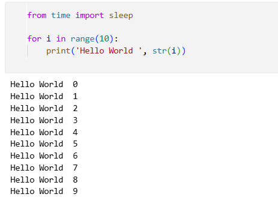

*Рисунок 1 — Вывод десяти сообщений в JupyterLab.*

### 2. Задержка выполнения

Проверена функция `sleep(2)`, приостанавливающая выполнение между итерациями цикла на две секунды.

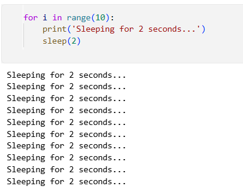

*Рисунок 2 — Вывод десяти сообщений с задержкой между итерациями.*

### Вывод по файлу 1

Освоены запуск ячеек Python и просмотр результатов их выполнения в JupyterLab.

## Ноутбук A — файл 2. Visualisation and Analysis

### 1. NumPy: массивы и генерация сигнала

Создана матрица 4×4 со значениями, полученными из нормального распределения с параметрами `μ = 0` и `σ = 1`.

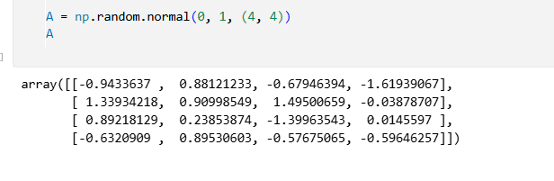

*Рисунок 3 — Генерация случайной матрицы NumPy.*

Изучены свойства массива: `ndim` — число измерений, `shape` — форма, `size` — количество элементов, `dtype` — тип данных. Для созданной матрицы это соответственно 2, `(4, 4)`, 16 и `float64`.

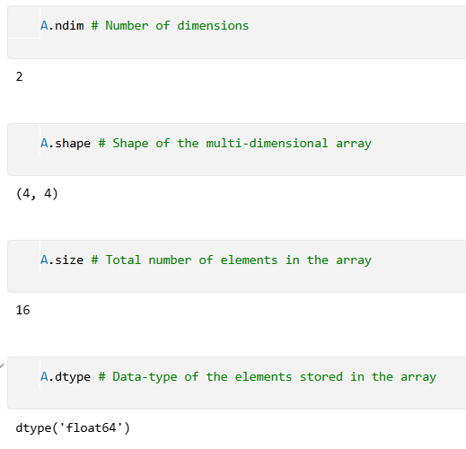

*Рисунок 4 — Основные характеристики двумерного массива.*

Проверены функции `zeros`, `ones`, `arange` и метод `reshape` для создания массивов и изменения их формы.

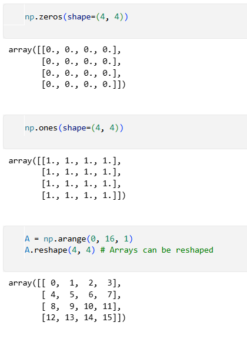

*Рисунок 5 — Массивы из нулей, единиц и последовательных чисел.*

Сформирован дискретный синусоидальный сигнал с частотой 20 Гц, частотой дискретизации 1000 Гц и числом отсчётов 100:

$$
x[n] = \sin\left(2\pi\frac{20n}{1000}\right).
$$

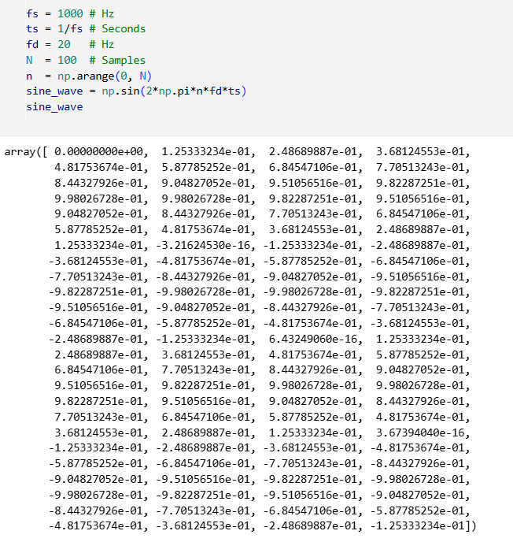

*Рисунок 6 — Значения сгенерированного синусоидального сигнала.*

### 2. Pandas: обработка табличных данных

На основе сгенерированного сигнала создана таблица `DataFrame` из 100 строк со столбцами `time` и `sine`.

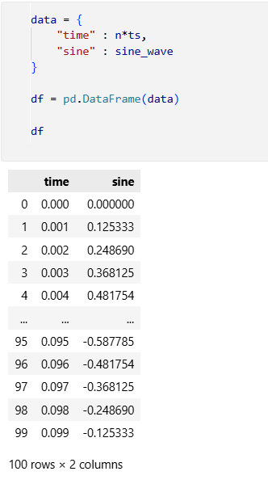

*Рисунок 7 — Временные отсчёты и значения сигнала в DataFrame.*

Продемонстрирована выборка одной и нескольких строк по индексам с помощью `df.loc`.

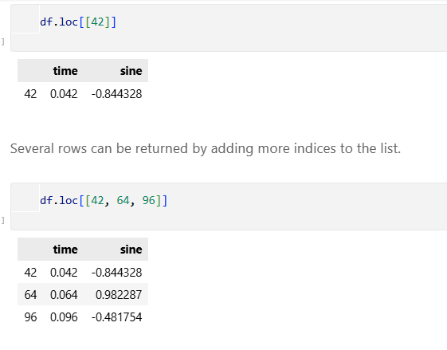

*Рисунок 8 — Получение строк с индексами 42, 64 и 96.*

Таблица экспортирована в CSV-файл и считана обратно. Появившийся столбец `Unnamed: 0` соответствует исходному индексу, который по умолчанию сохраняется функцией `to_csv`.

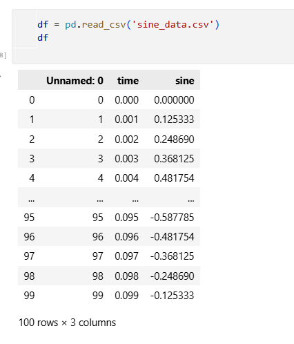

*Рисунок 9 — Чтение CSV и восстановление таблицы.*

### 3. SciPy: константы и оптимизация

С помощью `scipy.constants` получены длительности минуты, часа, дня, недели и года в секундах.

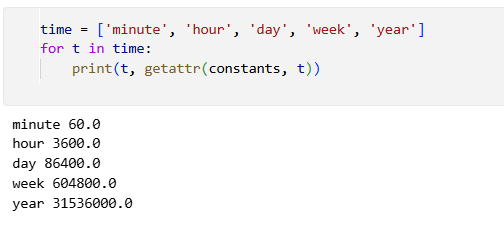

*Рисунок 10 — Вывод временных констант в секундах.*

Функцией `scipy.optimize.fmin` найден минимум квадратичной функции $f(y) = y^2$ при начальном приближении $y = 2$. Найденное значение аргумента близко к нулю.

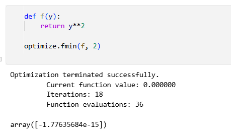

*Рисунок 11 — Поиск минимума функции $f(y) = y^2$.*

### 4. Matplotlib: визуализация сигнала

Для синусоидального сигнала, сформированного ранее с параметрами `fd = 20 Гц` и `fs = 1000 Гц`, построены два графика: дискретный (`stem`) и линейный (`plot`).

**Исправление исходного кода.** В ячейке построения дискретного графика исходного файла `02_visualisation_and_analysis.ipynb` применялся устаревший аргумент `use_line_collection=True`. В установленной версии Matplotlib он больше не поддерживается.

Было:

```python
plt.stem(n*ts, sine_wave, use_line_collection=True)
```

Стало:

```python
plt.stem(n*ts, sine_wave)
```

Удалён только несовместимый параметр; данные и способ построения графика не изменились. После исправления график `stem` был построен успешно (рисунок 12).

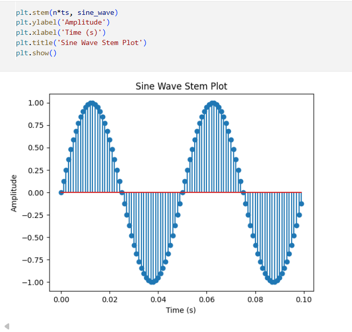

*Рисунок 12 — Представление отдельных отсчётов синусоиды с помощью `plt.stem`.*

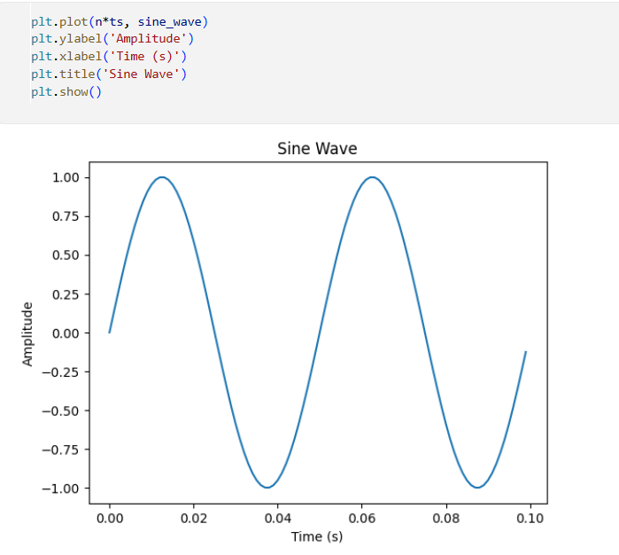

*Рисунок 13 — Представление того же сигнала линией с помощью `plt.plot`.*

Оба способа отображают одинаковые данные: первый акцентирует отдельные отсчёты, второй — общую форму сигнала.

### 5. Plotly: интерактивный график

С помощью `plotly.graph_objs` построен график той же синусоиды с подписями осей времени и амплитуды. В отличие от Matplotlib, Plotly поддерживает интерактивное исследование значений и масштабирование в поддерживаемой среде.

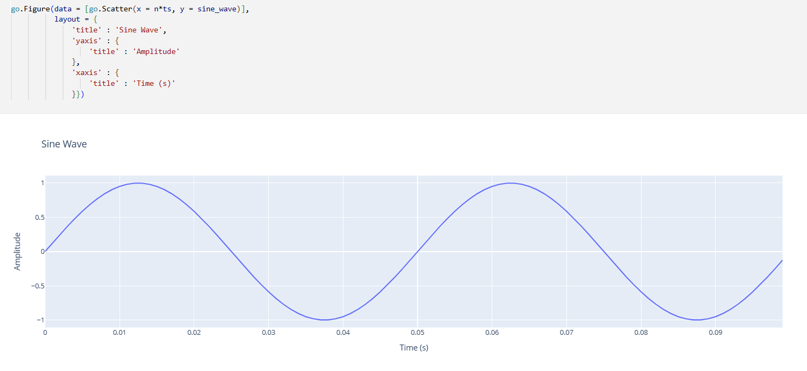

*Рисунок 14 — Построение синусоиды средствами Plotly.*

### 6. ipywidgets: создание ползунка

Создан виджет `IntSlider` с диапазоном от 0 до 7 и шагом 1. Код выполнил начальный вызов обработчика со значением `0`, однако **ползунок не отобразился**: Jupyter сообщил об ошибке отображения `application/vnd.jupyter.widget-view+json`. Поэтому проверить изменение значения с помощью интерфейса не удалось.

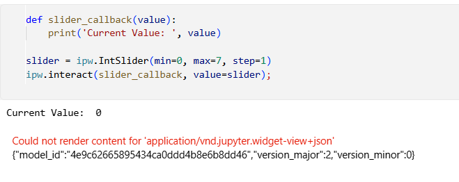

*Рисунок 15 — Начальный вывод обработчика и ошибка отображения виджета в текущей среде Jupyter.*

Эта проблема относится к отображению виджета в среде Jupyter; приведённый скриншот не подтверждает успешную работу интерактивного управления.

### Вывод по файлу 2

Освоены создание и анализ массивов NumPy, генерация сигнала, операции с таблицами Pandas, запись и чтение CSV, использование SciPy и построение графиков Matplotlib и Plotly. Код `ipywidgets` выполнился частично: начальное значение выведено, но отображение интерактивного элемента требует устранения ошибки окружения.


## Ноутбук A — файл 3. PYNQ Introduction

### Назначение

Файл знакомит с программной платформой **PYNQ** для управления программируемой логикой (FPGA) из Python. Рассматриваются структура PYNQ, библиотеки для работы с устройством и понятие *overlay* — аппаратной конфигурации FPGA. В примерах выполняются импорт `pynq`, загрузка `BaseOverlay('base.bit')` и запрос состояния RF-преобразователей.

### Ограничения выполнения

**Практическая часть не выполнялась.** Для работы с аппаратными компонентами необходимы совместимая плата RFSoC, установленная среда PYNQ и соответствующий overlay. На используемом Windows-ПК такая аппаратная среда отсутствует; установить только Python-модуль недостаточно для запуска этих ячеек. Содержимое изучено теоретически.

## Ноутбук A — файл 4. Overlays

### Назначение

Файл посвящён работе с аппаратными конфигурациями PYNQ на примере **Numerically Controlled Oscillator (NCO)** — цифрового генератора синусоидальных сигналов. Рассматриваются IP-ядра и драйверы `DefaultIP`/`DefaultHierarchy`, настройка частоты и амплитуды генератора, передача отсчётов из FPGA и построение временного графика и спектра через FFT.

### Ограничения выполнения

**Практическая часть не выполнялась.** Примеры используют `pynq_nco` и объект `NumericalOverlay()`, который взаимодействует с реальной FPGA. Без RFSoC-платы, аппаратного overlay и соответствующих драйверов их нельзя корректно запустить на обычном ПК. Изучены структура примера и назначение основных операций.

### Вывод по файлам 3 и 4

Рассмотрены принципы управления FPGA через PYNQ и применения аппаратного генератора NCO. Проверка аппаратных функций и получение измеренных данных не проводились из-за отсутствия необходимого оборудования и программной среды.

---

## Ноутбук B — файл 1. Sampling

### Цель

Исследовать дискретизацию гармонического сигнала и влияние частоты дискретизации на качество представления сигнала, а также наблюдать эффект наложения спектров (*aliasing*).

### 1. Моделирование исходного сигнала

Создана синусоида частотой **100 Гц**. Для приближения непрерывного сигнала выбрана высокая частота отсчётов **48 000 Гц**.

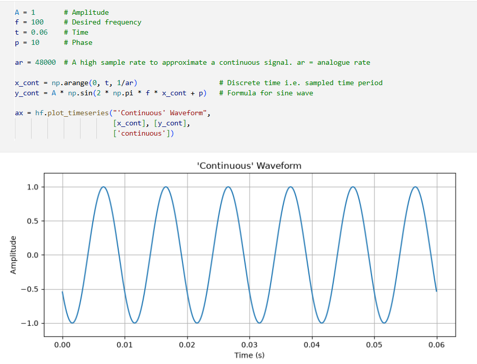

*Рисунок 16 — Исходный сигнал 100 Гц, представленный с высокой частотой дискретизации.*

### 2. Сравнение частот дискретизации

**Частота 100 Гц.** Один отсчёт на период сигнала: значения не позволяют восстановить колебания. Из-за постоянного фазового положения отсчёты совпадают по амплитуде.

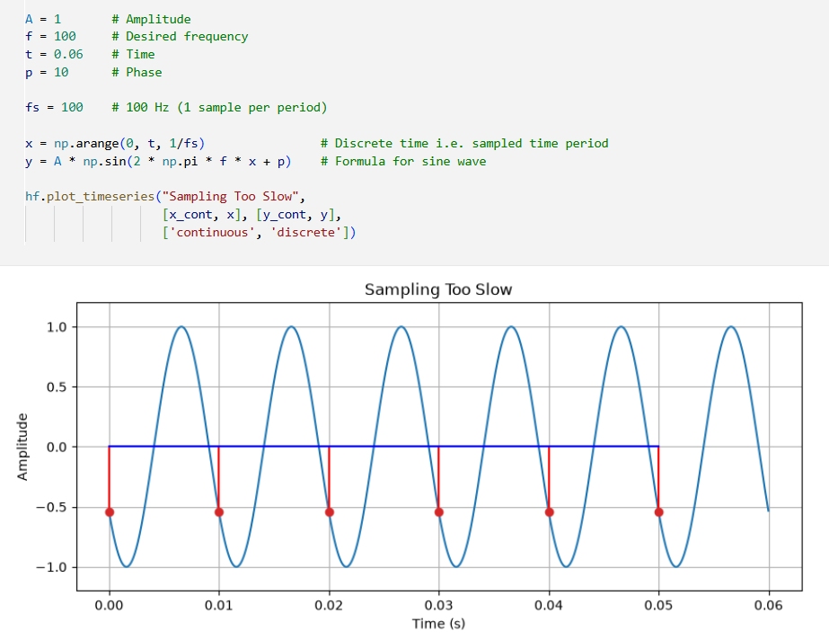

*Рисунок 17 — При 100 Гц точки отсчётов не описывают форму синусоиды.*

**Частота 80 Гц.** Она ниже удвоенной частоты исходного сигнала, поэтому отсчёты дают искажённое представление о его частоте.

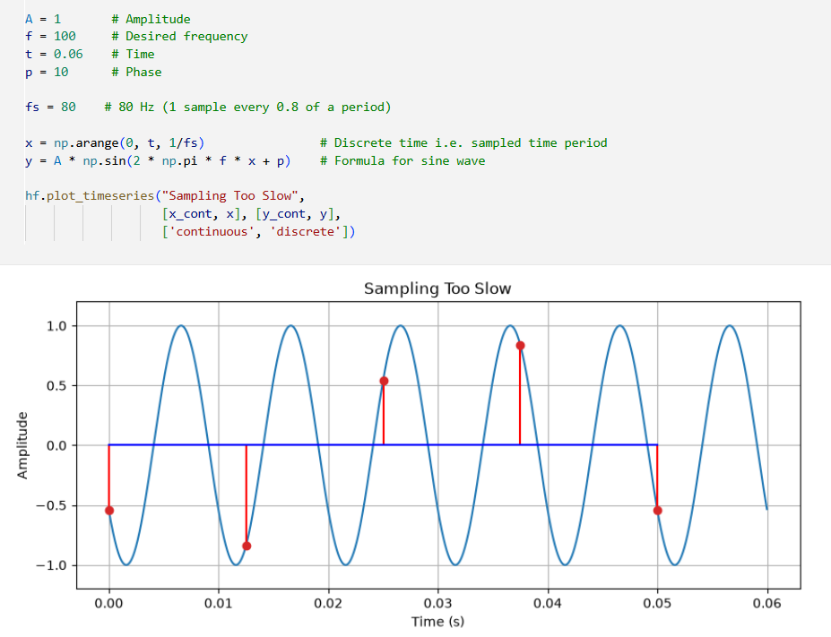

*Рисунок 18 — Недостаточная частота дискретизации и потеря информации о форме сигнала.*

**Частота 800 Гц.** На каждый период приходится восемь отсчётов; они уже хорошо описывают исходную форму.

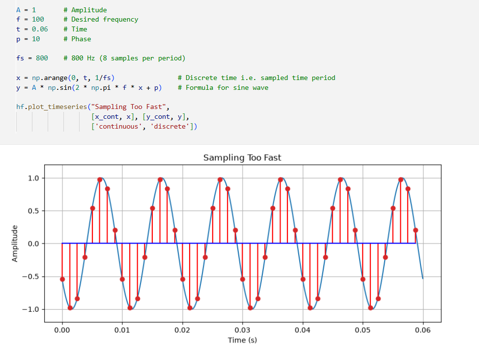

*Рисунок 19 — Восемь отсчётов на период позволяют передать форму синусоиды.*

**Частота 3000 Гц.** Число отсчётов увеличено до 30 на период. Представление становится плотнее, но возрастает объём обрабатываемых данных.

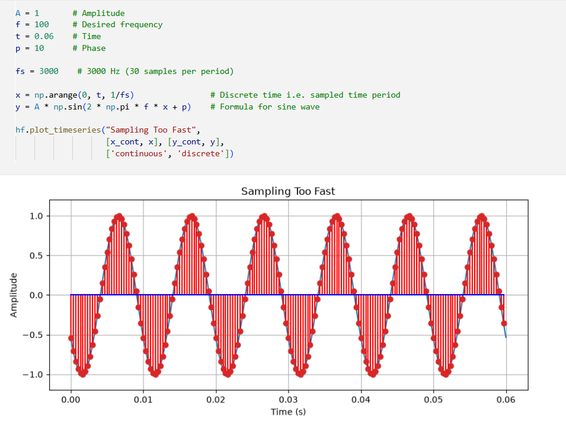

*Рисунок 20 — Более плотная дискретизация синусоидального сигнала.*

Согласно теореме отсчётов, для точного восстановления сигнала с ограниченным спектром требуется частота дискретизации выше удвоенной максимальной частоты сигнала:

$$
f_s > 2f_{max}.
$$

### 3. Эффект aliasing

При исходной частоте **100 Гц** и частоте дискретизации **80 Гц** возникает кажущаяся частота **20 Гц**. Дискретные значения совпадают с отсчётами более медленного колебания.

$$
f_{alias} = |100 - 80| = 20\ \text{Гц}.
$$

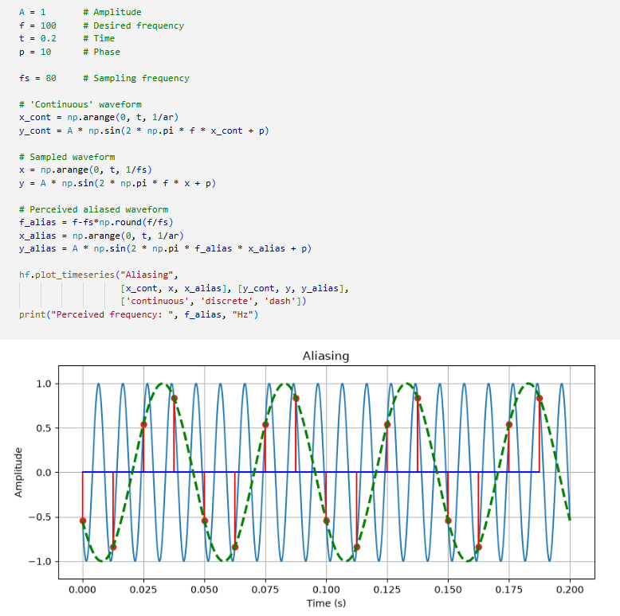

*Рисунок 21 — Исходный сигнал 100 Гц (синий), отсчёты (красный) и воспринимаемое колебание 20 Гц (зелёный пунктир).* 

### 4. Анализ спектров

В частотной области рассмотрены случаи без наложения и с наложением спектральных составляющих. Красной пунктирной линией отмечена половина частоты дискретизации, зелёной — частота дискретизации.

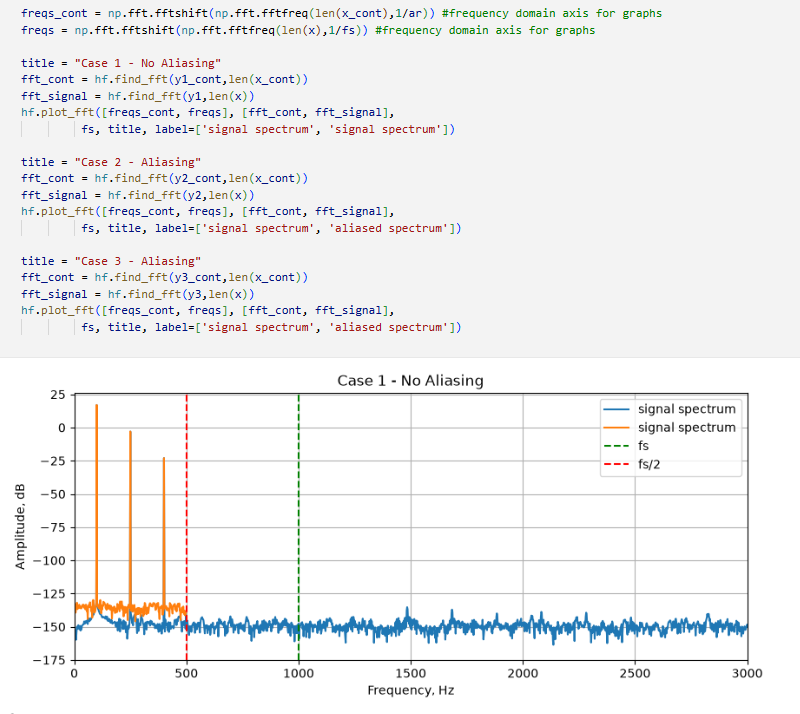

*Рисунок 22 — Пример спектра без aliasing (Case 1).*

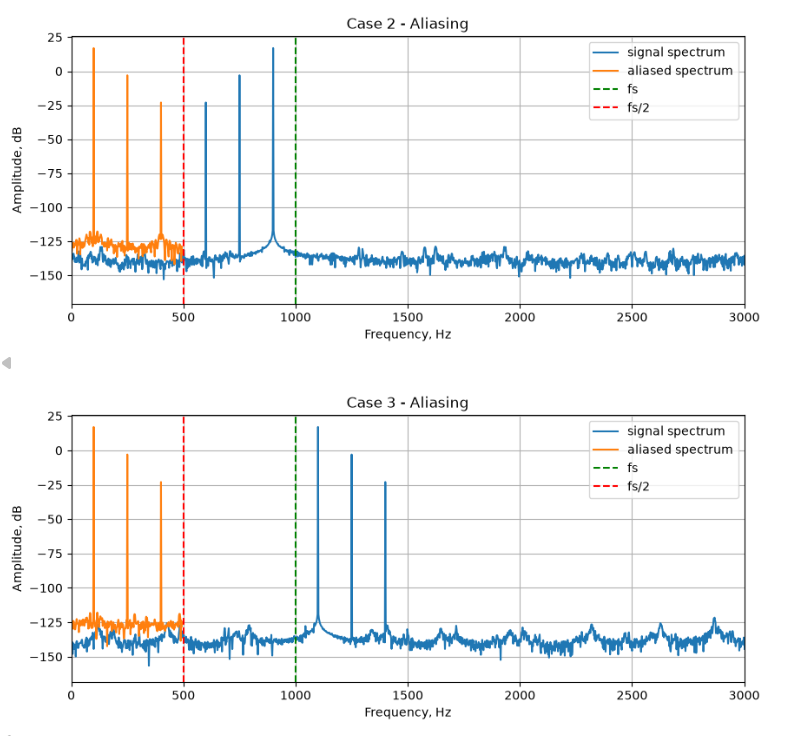

*Рисунок 23 — Случаи aliasing (Case 2 и Case 3): спектральные составляющие оказываются не на исходных частотах.*

### 5. Исправление совместимости

При выполнении файла первоначально возникла ошибка `TypeError: Axes.stem() got an unexpected keyword argument 'use_line_collection'`. В исходном вспомогательном модуле `rfsoc_book/helper_functions.py`, в функции `plot_timeseries()`, удалён устаревший аргумент:

**Было:**

```python
ax.stem(x[i], y[i], basefmt='blue', linefmt='red', markerfmt='C3o', use_line_collection=True)
```

**Стало:**

```python
ax.stem(x[i], y[i], basefmt='blue', linefmt='red', markerfmt='C3o')
```

После исправления и перезапуска ядра графики начали строиться корректно. Изменение сделано во вспомогательной библиотеке, а не в самом ноутбуке.

### Вывод по файлу 1

При низкой частоте дискретизации теряется возможность корректно восстановить исходный сигнал и возникает aliasing. Повышение частоты дискретизации улучшает временное представление, но увеличивает объём данных. Эффект aliasing подтверждён временными и спектральными графиками.

---

## Ноутбук B — файл 2. Quantisation

### Цель

Исследовать амплитудное квантование сигнала, влияние разрядности на точность представления и действие добавленного шума (*dithering*) на спектр.

### 1. Дискретизация и квантование

Сгенерирован синусоидальный сигнал частотой **13 Гц**, затем показаны отсчёты при `fs = 100 Гц` и результаты квантования с разрядностью **4 и 6 бит**. На рисунке объединены четыре соответствующих графика.

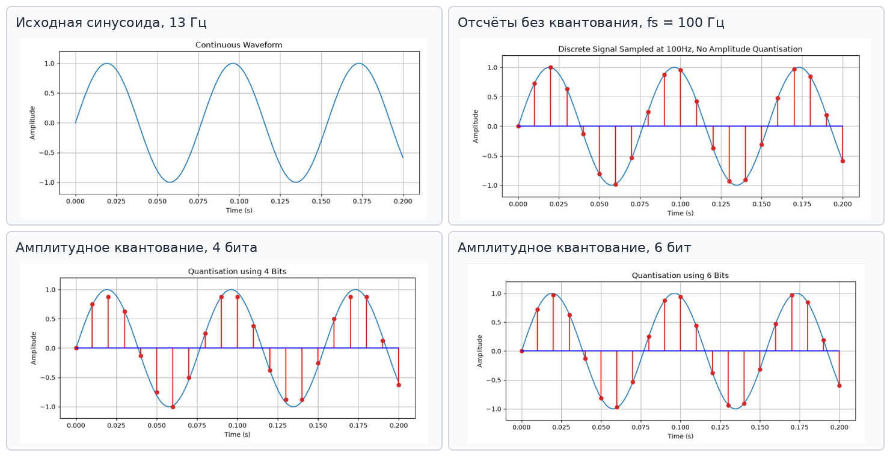

*Рисунок 24 — Исходная синусоида, отсчёты без квантования и результаты при 4 и 6 битах.*

Для диапазона от −1 до 1 использовались следующие значения:

| Параметр | 4 бита | 6 бит |
|---|---:|---:|
| Число уровней, $2^N$ | 16 | 64 |
| Шаг квантования, $2/2^N$ | 0,125 | 0,03125 |
| Приближённый динамический диапазон, $6{,}02N$ | 24 дБ | 36 дБ |

При увеличении разрядности отсчёты точнее приближаются к исходным значениям амплитуды.

### 2. Спектральные последствия квантования

Для синусоиды частотой **10,001 Гц** выполнено преобразование Фурье до и после 4-битного квантования.

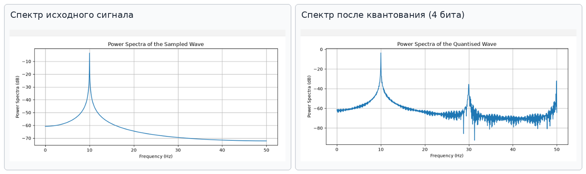

*Рисунок 25 — Спектр исходного сигнала и появление дополнительных спектральных составляющих после квантования.*

После квантования заметны дополнительные пики, вызванные искажениями амплитуды.

### 3. Дитеринг (dithering)

Перед повторным квантованием добавлен слабый гауссовский шум. Для шага `q = 0,125` в коде использована мощность шума $q^2/12 \approx 0{,}001302$.

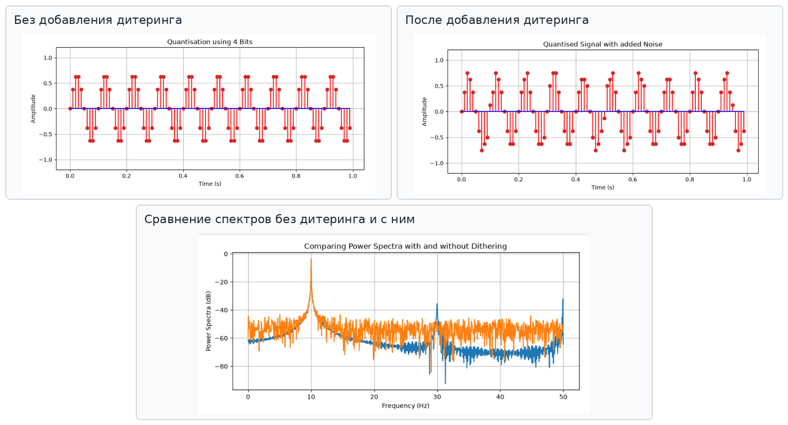

*Рисунок 26 — Сравнение сигналов и их спектров до и после добавления дитеринга.*

Добавление шума уменьшает выраженность отдельных паразитных гармоник, но повышает общий шумовой фон: искажения становятся менее коррелированными с полезным сигналом.

### Вывод по файлу 2

Увеличение числа бит снижает ошибку амплитудного квантования. Квантование порождает спектральные искажения, а дитеринг перераспределяет их в более равномерный шум ценой повышения шумового фона.

---

## Ноутбук B — файл 3. ADCs and DACs

### Цель

Исследовать аналого-цифровое и цифро-аналоговое преобразование: наложение спектров, антиалиасинговую фильтрацию, удержание отсчётов и восстановление сигнала.

### 1. Дискретизация и наложение спектров

Сформирован сигнал из двух гармоник **50 и 240 Гц** с добавлением слабого шума. При дискретизации с частотой **200 Гц** составляющая 240 Гц отображается в спектре как **40 Гц** (aliasing), а 50 Гц остаётся в допустимой полосе.

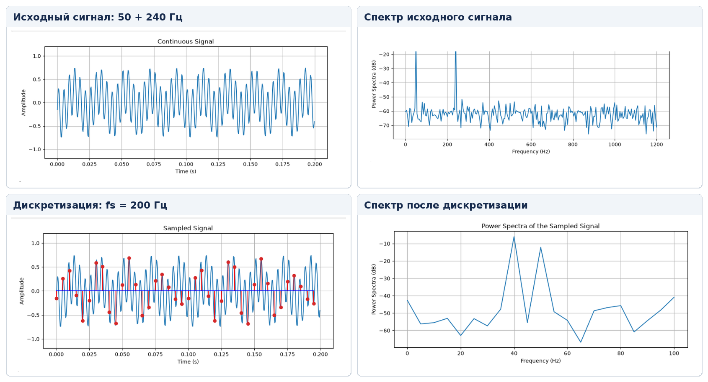

*Рисунок 27 — Исходный сигнал и его спектр (верхний ряд), отсчёты при 200 Гц и их спектр (нижний ряд).*

### 2. Антиалиасинговый фильтр

Перед дискретизацией применён низкочастотный фильтр для подавления высокочастотных составляющих. Ниже сопоставлена форма исходного сигнала и результата фильтрации.

**Исправление исходного кода.** В файле `03_adcs_and_dacs.ipynb`, в функции `generate_lowpass()`, использовался устаревший аргумент `Hz` библиотеки SciPy. При выполнении возникала ошибка `TypeError: remez() got an unexpected keyword argument 'Hz'`.

Было:

```python
taps = signal.remez(numtaps, [0, cutoff, stop, 0.5*fs], [1, 0], Hz=fs)
```

Стало:

```python
taps = signal.remez(numtaps, [0, cutoff, stop, 0.5*fs], [1, 0], fs=fs)
```

После замены `Hz=fs` на `fs=fs` фильтр удалось рассчитать и продолжить выполнение тетрадки.

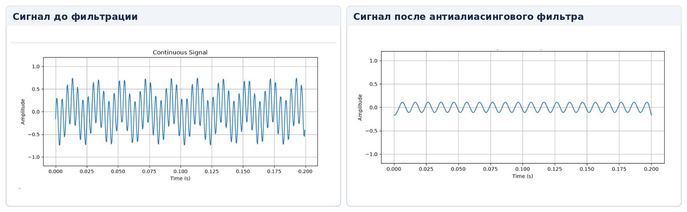

*Рисунок 28 — Сопоставление исходного и отфильтрованного сигналов во временной области.*

### 3. Цифро-аналоговое преобразование

Исследован метод удержания нулевого порядка (**Zero-Order Hold**, ZOH), при котором значение отсчёта сохраняется до следующего отсчёта. Затем выполнена интерполяция с коэффициентом **R = 3** и сглаживание ступенчатого сигнала реконструкционным фильтром.

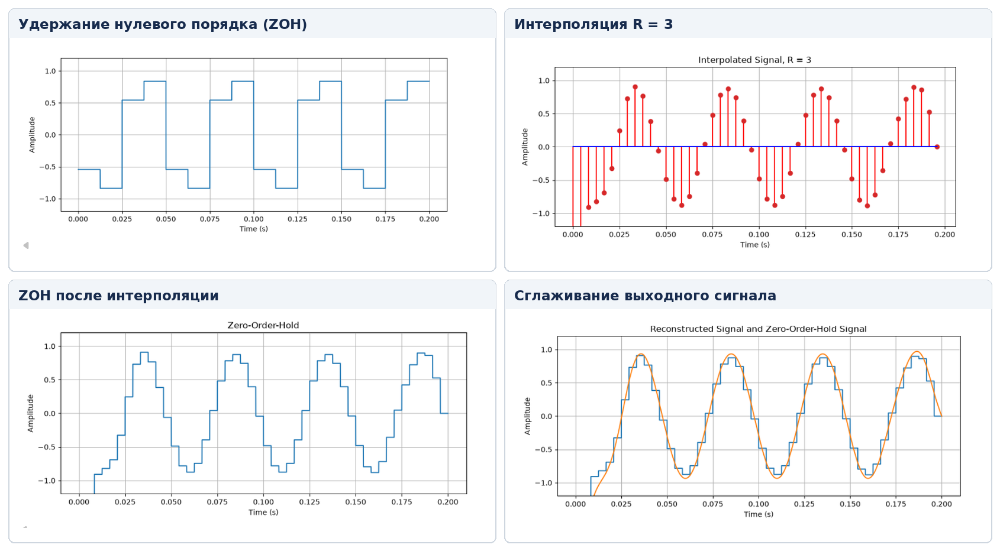

*Рисунок 29 — Сравнение ZOH, интерполяции и результата сглаживания реконструкционным фильтром.*

### Вывод по файлу 3

Продемонстрированы искажения спектра при недостаточной частоте дискретизации, роль антиалиасингового фильтра и способы формирования непрерывно выглядящего сигнала из цифровых отсчётов. Все результаты получены **программным моделированием**, без физического АЦП/ЦАП.

---

## Ноутбук B — файл 4. Digital Filter Design

### Цель

Изучить проектирование цифровых FIR-фильтров и сравнить их амплитудно-частотные и фазовые характеристики, а также методы расчёта коэффициентов.

### 1. Частотные характеристики фильтра

Построены **АЧХ** низкочастотного фильтра и его **фазовая характеристика**. В полосе пропускания усиление близко к 0 дБ; за переходной областью наблюдается подавление частот и боковые лепестки. Фазовый отклик в полосе пропускания близок к линейному.

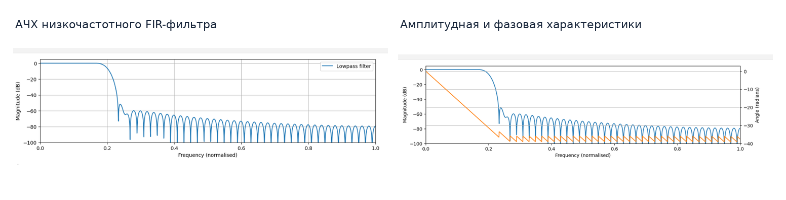

*Рисунок 30 — АЧХ ФНЧ (слева) и совместное представление АЧХ/ФЧХ (справа).*

### 2. Применение оконных функций

Сравнены окна **Hamming, Hann и Blackman**. Оконная функция умножает усечённую идеальную импульсную характеристику и уменьшает спектральную утечку. На графиках сопоставлены формы окон и результаты взвешивания импульсного отклика.

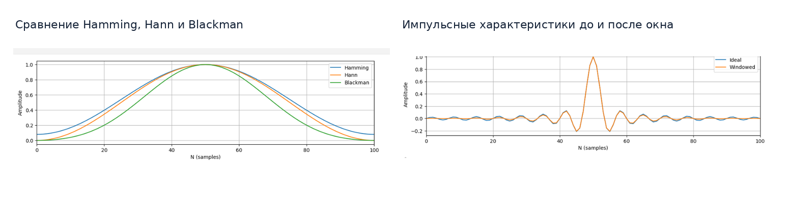

*Рисунок 31 — Разные формы окон (слева) и идеальный/оконный импульсный отклик (справа).*

На частотных характеристиках видно влияние окна: **уменьшаются боковые лепестки, но изменяются ширина переходной полосы и неравномерность в полосе пропускания**.

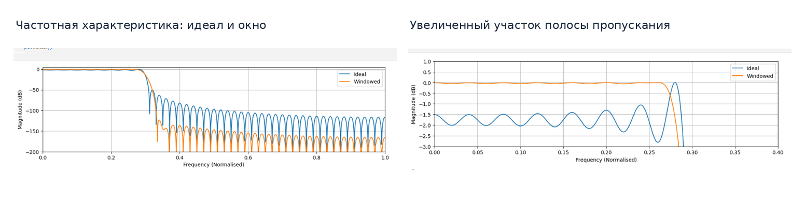

*Рисунок 32 — Частотный отклик идеального и оконного фильтров, а также увеличенный участок полосы пропускания.*

### 3. Сравнение методов проектирования

Для полосозаграждающего фильтра рассмотрены **метод окон**, **алгоритм Паркса — Макклеллана** (`remez`) и **метод наименьших квадратов** (`firls`). Все три формируют область подавления, но различаются характером переходных полос, уровнем подавления и амплитудными пульсациями.

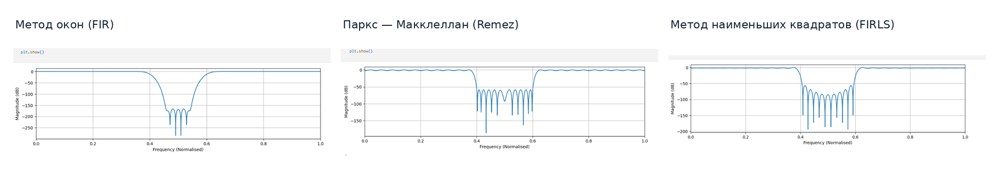

*Рисунок 33 — АЧХ полосозаграждающих фильтров, рассчитанных тремя методами.*

### Вывод по файлу 4

Исследованы характеристики FIR-фильтров и способы их проектирования. Установлено, что выбор оконной функции и алгоритма расчёта влияет на компромисс между шириной переходной полосы, подавлением нежелательных частот и пульсациями АЧХ.

---

## Общий вывод по лабораторной работе №1

В ходе работы освоены JupyterLab и базовые инструменты научных вычислений Python: NumPy, Pandas, SciPy, Matplotlib и Plotly. На примерах моделирования цифровых сигналов исследованы **дискретизация, aliasing, квантование, дитеринг, АЦП/ЦАП и FIR-фильтрация**. Полученные графики иллюстрируют влияние частоты дискретизации, разрядности квантования и параметров фильтра на свойства сигнала.

Для запуска исходных примеров на актуальных версиях библиотек внесены исправления совместимости: удалён `use_line_collection=True` из вызовов `plt.stem()` (файл A02 и `helper_functions.py` для B01) и заменён аргумент `Hz=fs` на `fs=fs` в `signal.remez()` (B03).

**Ограничения:** аппаратные файлы **A03–A04** изучены теоретически, но не запускались без RFSoC-платы и среды PYNQ. В **A02** виджет `ipywidgets` не отобразился из-за ошибки среды Jupyter; остальные представленные программные результаты получены при выполнении ноутбуков.
