# Лабораторная работа №2

## Цель работы

Изучить принципы спектрального анализа радиосигналов и средства анализа частотного спектра на RFSoC. Практическая часть с преобразованием Фурье выполняется в программных ноутбуках Notebook C.

## Ноутбук C — файл 1. Exploring the Spectrum

### 1. Подготовка оборудования и программного обеспечения

В ноутбуке рассматривается приём радиосигналов с помощью платформы **RFSoC4x2**. Для работы требуется подключить антенну к входу `ADC_A`, загрузить аппаратный overlay с помощью библиотеки `rfsoc_sam` и получить доступ к спектральному анализатору АЦП. В качестве интерфейса визуализации используется интерактивный график спектра.

Предусмотрены инициализация `Overlay()`, выбор приёмного канала `sam.radio.receiver.channel_22.frontend`, отображение спектра `adc.analyser.spectrum()` и включение анализатора параметром `spectrum_enable`.

**Аппаратная часть не выполнялась:** в используемой среде отсутствует физическая плата RFSoC4x2. Поэтому загрузка FPGA-overlay, приём реального радиосигнала и запуск анализатора невозможны. Приведённые в исходном ноутбуке спектры являются демонстрационными примерами, а не результатами собственных измерений.

### 2. Исследуемые диапазоны частот

В исходном ноутбуке приведены примеры настройки анализатора на следующие диапазоны:

| Вид радиосвязи | Рассматриваемый диапазон | Центральная частота в примере |
|---|---:|---:|
| FM-радиовещание | 88–108 МГц | 98 МГц |
| Цифровое радиовещание DAB | 210–230 МГц | 220 МГц |
| Цифровое телевидение UHF | 470–700 МГц | 595 МГц |
| Мобильная связь | 700–1000 МГц | 850 МГц |
| Мобильная связь | 1700–2200 МГц | 1800 МГц |

Для переключения между диапазонами в коде меняются `centre_frequency` и `decimation_factor`; для примера цифрового телевидения дополнительно задаётся `number_frames = 64`. Также кратко рассматривается регулирование использования радиочастотного спектра.

### Вывод по файлу 1

Изучена последовательность настройки радиочастотного спектрального анализатора и назначение основных параметров приёма. Экспериментальные измерения пропущены из-за отсутствия RFSoC-платы.

## Ноутбук C — файл 2. RFSoC Spectrum Analyser

### 1. Назначение анализатора

Во втором ноутбуке рассматривается приложение **RFSoC Spectrum Analyser Module (RFSoC-SAM)**. Сигнал поступает на радиочастотный АЦП; предварительная обработка выполняется в программируемой логике FPGA (PL), а результаты передаются в процессорную систему (PS) для отображения и управления.

Для запуска предполагается загрузить `Overlay(init_rf_clks=True)` и вызвать `sam.spectrum_analyzer_application()`. Приложение открывается через **Voila** как отдельная интерактивная панель.

### 2. Возможности интерфейса

По описанию и изображению интерфейса в исходном ноутбуке предусмотрены переключение каналов АЦП, отображение частотного спектра, включение анализатора и спектрограммы, изменение центральной частоты и полосы анализа. Отдельно показываются частота дискретизации и разрешение FFT.

**Аппаратная часть не выполнялась:** без платы RFSoC невозможно инициализировать RFSoC-SAM, получить данные с АЦП и проверить работу интерактивного анализатора. Функции интерфейса изучены по материалам исходного ноутбука; собственные измерения отсутствуют.

### Вывод по файлу 2

Рассмотрены назначение и архитектура RFSoC-SAM, а также основные элементы интерфейса спектрального анализатора. Аппаратный запуск пропущен по причине отсутствия необходимого оборудования.

## Ноутбук C — файл 3. Fourier's Theorem

### Цель

Исследовать представление периодических сигналов с помощью тригонометрического и комплексного рядов Фурье, а также влияние количества членов разложения на точность приближения. Примеры выполнены программно с использованием NumPy, SciPy и Matplotlib, без RFSoC-платы.

### 1. Приближение прямоугольного сигнала

Вначале сформирован прямоугольный сигнал с амплитудой **3** и постоянной составляющей **+3**. С помощью `scipy.integrate.quad` вычислены коэффициенты ряда Фурье: постоянная составляющая $a_0$, косинусные $a_n$ и синусные $b_n$. Затем построены приближения с различным числом членов разложения.

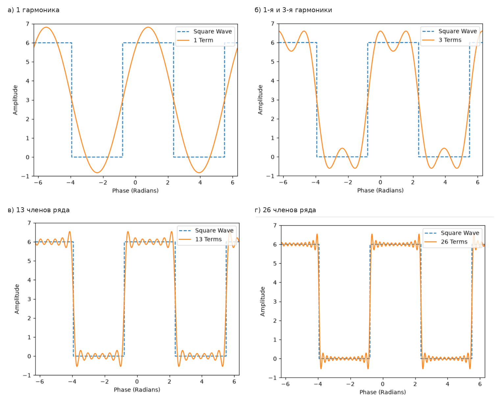

*Рисунок 1 — Сравнение приближения прямоугольного сигнала при использовании 1, 3, 13 и 26 членов ряда Фурье.*

При увеличении числа членов ряда приближение лучше передаёт горизонтальные участки сигнала и крутые переходы. Вблизи разрывов заметны колебания и выбросы — **эффект Гиббса**. При дальнейшем увеличении числа членов эти колебания сужаются около разрыва, но максимальный относительный выброс не исчезает полностью.

### 2. Разложение пилообразного сигнала

Для пилообразного сигнала с периодом **0,5 с**, амплитудой **0,5** и постоянной составляющей **+0,5** построены приближения с одним, двумя и тремя членами ряда.

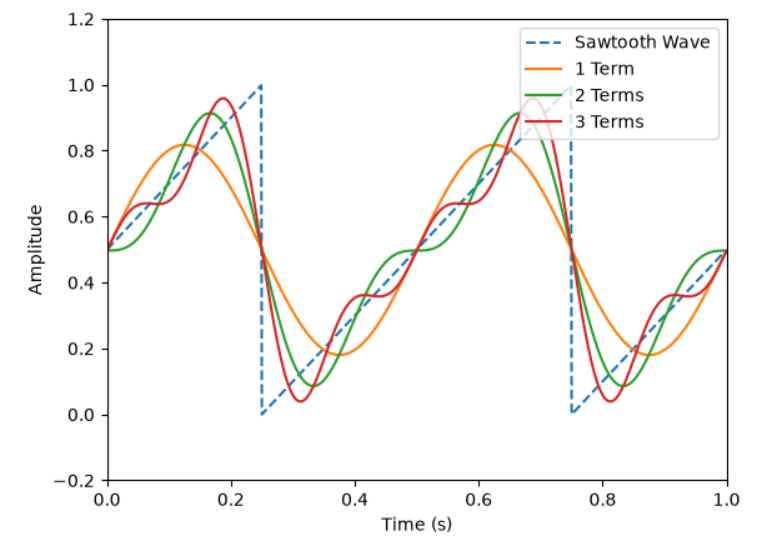

*Рисунок 2 — Исходный пилообразный сигнал и приближения рядом Фурье с 1, 2 и 3 членами.*

Добавление гармоник улучшает воспроизведение наклонных участков, однако при малом числе членов ряда переходы остаются сглаженными, а вблизи разрывов наблюдаются колебания.

### 3. Формула Эйлера и комплексный ряд Фурье

Рассмотрено представление комплексных чисел через формулу Эйлера $e^{j\theta}=\cos\theta+j\sin\theta$. Для проверки комплексного разложения сформирован сигнал с **пилообразной действительной частью** и **прямоугольной мнимой частью**. Вычислены комплексные коэффициенты и построено приближение рядом Фурье с **9 членами по параметру `n`** (гармоники от $-9$ до $9$).

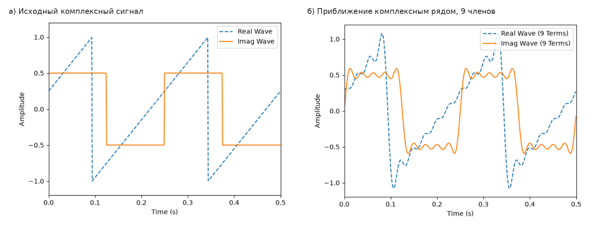

*Рисунок 3 — Действительная и мнимая части исходного комплексного сигнала (слева) и их приближение комплексным рядом Фурье (справа).*

Восстановленный сигнал повторяет основную форму обеих составляющих; возле разрывов и резких переходов видны характерные колебания приближения.

### Вывод по файлу 3

Программные эксперименты показали, что периодические сигналы можно представить суммой гармоник. При увеличении числа членов ряда точность приближения возрастает, а у разрывных сигналов сохраняются локальные колебания, связанные с эффектом Гиббса. Комплексная форма ряда Фурье позволяет анализировать одновременно действительную и мнимую части сигнала.

## Ноутбук C — файл 4. Investigating the DFT

### Цель

Изучить дискретное преобразование Фурье (DFT), представление амплитуды и фазы, положительные и отрицательные частоты, частотное разрешение, спектральную утечку, оконные функции и дополнение сигнала нулями. Эксперименты выполнялись программно в JupyterLab.

### 1. Вычисление и визуализация DFT

Сформирован дискретный сигнал из косинусоид частотой **3 и 9 кГц** при частоте дискретизации **48 кГц** и числе отсчётов **N = 16**. DFT вычислено по определению; отдельно построены модуль и фаза комплексного спектра.

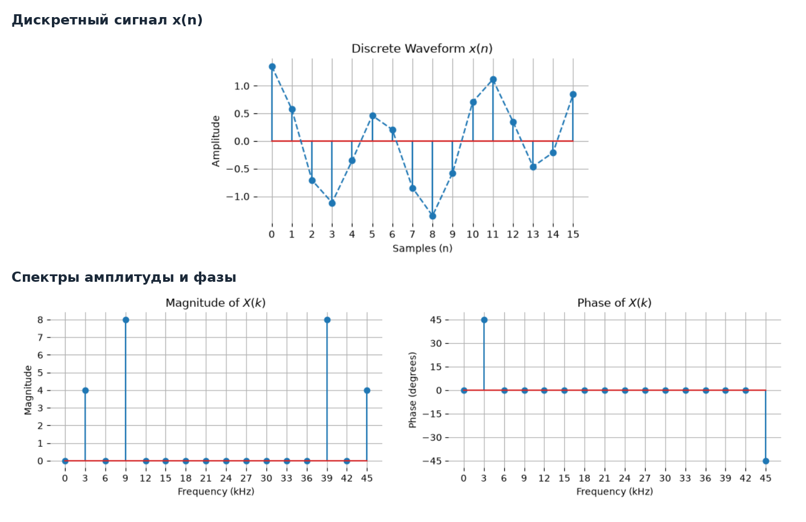

*Рисунок 4 — Исходный дискретный сигнал; амплитудный и фазовый спектры.*

В спектре присутствуют составляющие на 3 и 9 кГц и симметричные им компоненты в области 39 и 45 кГц. Это соответствует свойству комплексно-сопряжённой симметрии DFT действительного сигнала.

### 2. Комплексные экспоненты и отрицательные частоты

Исследовано представление косинусоиды как суммы комплексных экспонент с положительной и отрицательной частотой. В трёхмерном представлении экспоненты имеют противоположные направления вращения, а их сумма образует действительную косинусоиду.

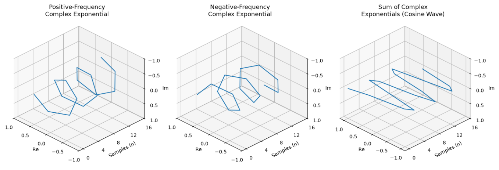

*Рисунок 5 — Комплексные экспоненты и их сумма.*

### 3. Частотные отсчёты и разрешение

Для синусоидального сигнала **125 Гц** выполнено сравнение при разных параметрах дискретизации:

| Частота дискретизации | Число отсчётов | Шаг частотной сетки, Δf = fs/N |
|---|---:|---:|
| 1000 Гц | 8 | 125 Гц |
| 1000 Гц | 16 | 62,5 Гц |
| 500 Гц | 8 | 62,5 Гц |

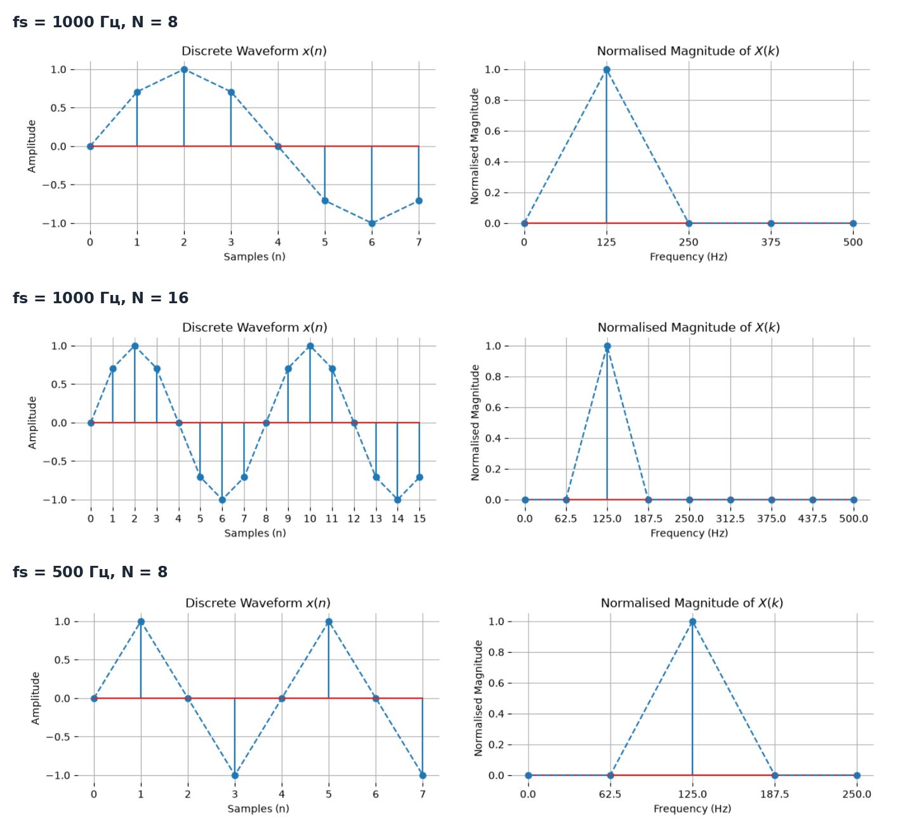

*Рисунок 6 — Изменение частотной сетки DFT при увеличении числа отсчётов и снижении частоты дискретизации.*

Увеличение длительности наблюдения за счёт большего количества отсчётов при фиксированной частоте дискретизации позволяет различать более близкие частоты. При снижении частоты дискретизации также уменьшается шаг сетки, однако одновременно снижается частота Найквиста.

### 4. Спектральная утечка и оконные функции

При анализе синусоиды **80 Гц**, частота которой не совпадает с центром бина DFT (**fs = 1000 Гц, N = 16, Δf = 62,5 Гц**), наблюдается **спектральная утечка**: энергия сигнала распределяется между несколькими частотными отсчётами.

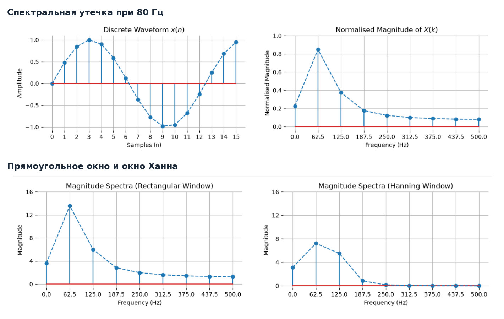

*Рисунок 7 — Спектральная утечка и сравнение спектров с прямоугольным окном и окном Hann.*

Применение окна Hann уменьшает дальние боковые составляющие по сравнению с прямоугольным окном, но расширяет главный лепесток спектра.

Дополнительно рассмотрены **пять оконных функций**: Rectangular, Hamming, Hann (Hanning), Blackman и Bartlett.

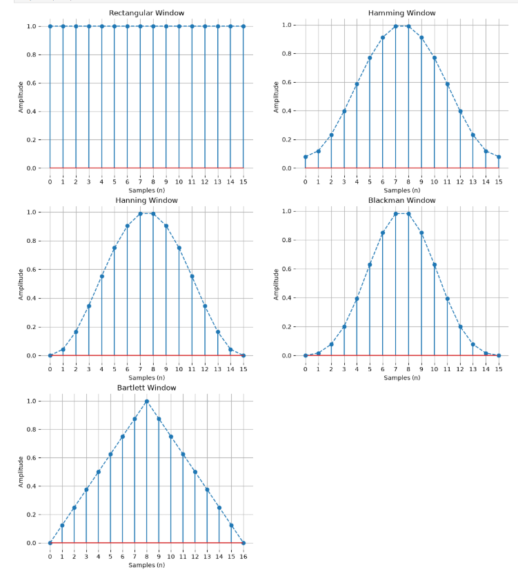

*Рисунок 8 — Оконные функции во временной области.*

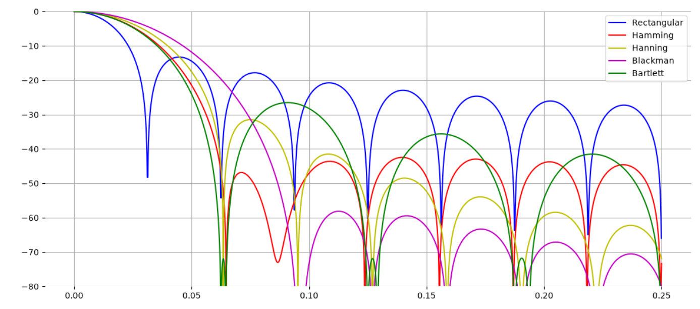

*Рисунок 9 — Сравнение частотных характеристик окон: компромисс между шириной главного лепестка и подавлением боковых лепестков.*

### 5. Scalloping loss

Для прямоугольного окна и окна Hann получены результаты **0,6376** и **0,8661** соответственно. Для полноты сравнения по функции `scallop_loss()` из ноутбука рассчитаны значения и для остальных окон при **N = 16**:

| Окно | Scalloping loss (линейный коэффициент) | Потеря, дБ |
|---|---:|---:|
| Rectangular | 0,6376 | −3,91 |
| Hamming | 0,8304 | −1,61 |
| Hann | 0,8661 | −1,25 |
| Blackman | 0,8949 | −0,96 |
| Bartlett | 0,8338 | −1,58 |

*Первые два показателя (Rectangular и Hann) также подтверждены присланным выводом Jupyter; остальные рассчитаны по той же формуле для сравнения окон.* Чем ближе коэффициент к единице, тем меньше потеря амплитуды при попадании частоты между соседними бинами. Для рассмотренных окон наименьшая потеря получается у Blackman.

### 6. Дополнение нулями (zero-padding)

Исследовано дополнение исходных **16** отсчётов до **32** и **48** точек перед DFT при **fs = 2000 Гц**.

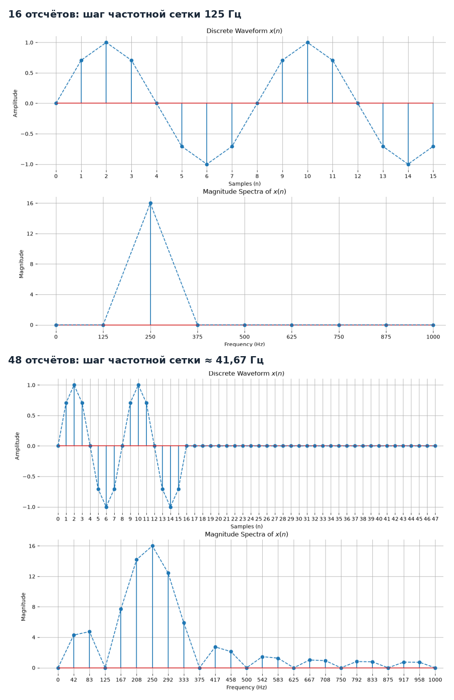

*Рисунок 10 — Сравнение спектральной сетки для 16 и 48 точек; промежуточный вариант для 32 точек также выполнен.*

| Длина DFT | Шаг частотной сетки |
|---|---:|
| 16 | 125 Гц |
| 32 | 62,5 Гц |
| 48 | ≈ 41,67 Гц |

Дополнение нулями делает спектр визуально более подробным за счёт более плотной частотной сетки, **но не добавляет информации об исходном сигнале и не улучшает физическую способность разделять близкие частоты**.

### Исправления совместимости

В файле `04_investigating_the_dft.ipynb` удалён больше не поддерживаемый аргумент `use_line_collection=True` из вызовов `Axes.stem()` — внутри вспомогательной функции `stem_plot()` и в отдельных ячейках построения графиков спектральной утечки и окон. После исправления соответствующие визуализации выполняются в установленной версии Matplotlib.

### Вывод по файлу 4

В ходе работы исследованы свойства DFT, влияние частоты дискретизации и числа отсчётов на частотную сетку, а также причины спектральной утечки. Сравнение окон показало различие между подавлением боковых лепестков, шириной главного лепестка и scalloping loss. Дополнение нулями увеличивает плотность частотной сетки без увеличения объёма исходной информации.

## Ноутбук C — файл 5. Fast Fourier Transform

### Цель

Изучить ускоренное вычисление DFT с помощью быстрого преобразования Фурье (FFT), сравнить производительность двух реализаций и исследовать кратковременное преобразование Фурье (STFT) на спектрограммах.

### 1. Реализация FFT и проверка спектра

Для тестового сигнала, состоящего из косинусоид **6 и 12 кГц** при частоте дискретизации **48 кГц**, рассмотрено разложение восьмиточечного DFT на более короткие преобразования по чётным и нечётным индексам. Далее использована рекурсивная реализация FFT (decimation in time) и выполнено сравнение с обычным DFT.

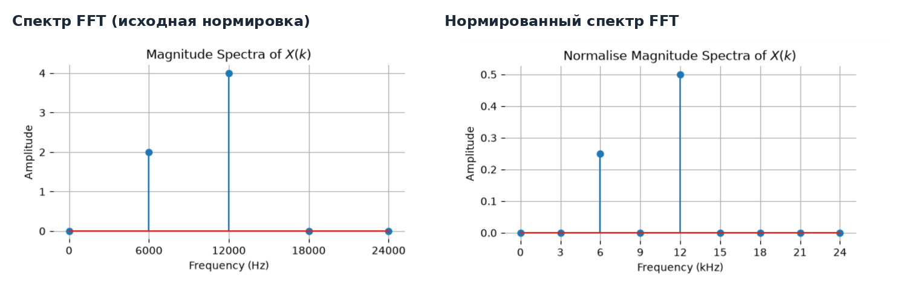

*Рисунок 11 — Амплитудный спектр тестового сигнала и его нормированное представление: компоненты 6 и 12 кГц.*

Проверка равенства результатов FFT и DFT после округления до двух десятичных знаков возвращает `True`.

### 2. Сравнение скорости DFT и FFT

Для **N = 2048** измерено время выполнения реализации DFT по определению и рекурсивного FFT.

| Показатель | DFT | FFT |
|---|---:|---:|
| CPU time (total) | 609 мс | 78,1 мс |
| Wall time | 652 мс | 82,4 мс |

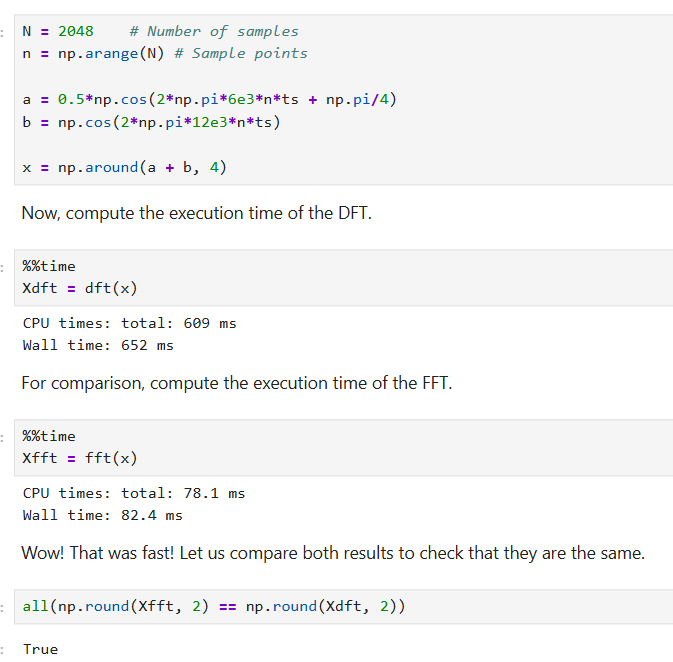

*Рисунок 12 — Результаты измерения времени и проверка `True` для совпадения спектров после округления.*

На приведённом запуске FFT выполняется **примерно в 7,9 раза быстрее** по реальному времени (*wall time*). Это результат конкретного измерения, а не постоянный коэффициент ускорения. Причина выигрыша — уменьшение вычислительной сложности с порядка **O(N²)** до **O(N log N)** для рассматриваемой реализации FFT.

### 3. Кратковременное преобразование Фурье (STFT)

При STFT сигнал разделяется на короткие фрагменты, к каждому применяется оконная функция и FFT. Результаты отображаются в виде спектрограммы, показывающей изменение частотного состава во времени.

В ноутбуке рассматривается сигнал из трёх постоянных гармоник (**60, 120 и 250 Гц**) и **chirp-сигнал**, частота которого увеличивается. Для отчёта приведены присланные результаты для chirp-сигнала.

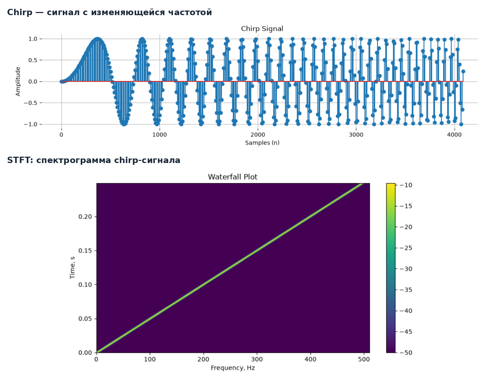

*Рисунок 13 — Сигнал с нарастающей частотой и соответствующая спектрограмма STFT: диагональная полоса показывает рост частоты.*

**Замечание:** в исходной ячейке временная ось спектрограммы вычислена как `np.arange(int(L/N))/fs`. При длине окна `N` корректное время начала каждого кадра для неперекрывающихся окон равно `np.arange(int(L/N))*N/fs`. Поэтому шкала времени на исходном скриншоте не соответствует фактической длительности записи, хотя характер изменения частоты виден правильно.

### Исправления совместимости

В `05_fast_fourier_transform.ipynb` во вспомогательной функции `stem_plot()` удалён устаревший аргумент `use_line_collection=True` в вызовах `Axes.stem()`. Это позволяет выполнять графики на современной версии Matplotlib без ошибки `unexpected keyword argument`.

### Вывод по файлу 5

Эксперимент показал совпадение результатов FFT и DFT при значительном ускорении вычислений в реализации FFT. Применение STFT позволяет видеть не только частотный состав сигнала, но и его изменение во времени: на спектрограмме chirp-сигнала наблюдается последовательное повышение частоты.

## Общий вывод по лабораторной работе №2

В лабораторной работе изучены методы частотного анализа сигналов. По материалам C01–C02 рассмотрены приём радиосигналов на RFSoC, назначение радиочастотных АЦП и работа аппаратного спектрального анализатора. **Аппаратные эксперименты не проводились ввиду отсутствия RFSoC-платы**, поэтому результаты их запуска не заявляются.

Программные ноутбуки C03–C05 выполнены в JupyterLab. Исследованы действительный и комплексный ряды Фурье, эффект Гиббса, дискретное преобразование Фурье, положительные и отрицательные частоты, спектральная утечка и оконные функции. Установлено, как количество отсчётов, частота дискретизации и дополнение нулями влияют на частотное представление сигнала.

Также реализован алгоритм FFT и выполнено сравнение его скорости с прямым DFT: на тесте с 2048 отсчётами FFT оказался приблизительно в 7,9 раза быстрее. По спектрограмме STFT продемонстрировано изменение частоты chirp-сигнала во времени. Для совместимости с установленной версией Matplotlib исправлены устаревшие вызовы `Axes.stem()` в файлах C04 и C05.

