# Лабораторная работа №3

## Цель работы

Изучить основы беспроводных систем связи и физического уровня (PHY) модели OSI, влияние характеристик радиоканала на качество сигнала, цифровые методы модуляции и формирование передаваемых импульсов. На программных моделях исследовать BPSK, QPSK и 16-QAM, аддитивный белый гауссовский шум (AWGN), показатели SNR, EVM, BER и SER, а также фильтры прямоугольной формы, sinc, Raised Cosine (RC) и Root Raised Cosine (RRC).

Практические исследования проводились в Python/JupyterLab по файлам `notebook_D/01_baseband_modulation.ipynb`, `02_evm_and_ber.ipynb` и `03_pulse_shaping.ipynb`. RFSoC-плата для выполнения этих трёх программных ноутбуков не требовалась.

## Краткие теоретические сведения

### 1. Модель OSI и физический уровень

Модель OSI разделяет сетевое взаимодействие на семь уровней: физический (PHY), канальный, сетевой, транспортный, сеансовый, представления и прикладной. **Физический уровень** отвечает за передачу битов в виде физических сигналов, включая электрические и радиочастотные параметры, выбор способа передачи, синхронизацию и модуляцию. В беспроводной системе передатчик преобразует последовательность битов в комплексные символы, формирует импульсы и передаёт радиосигнал; приёмник выполняет обратную обработку.

### 2. Радиоканал и его неидеальности

В качестве простой модели зашумлённого приёма используется

$$
r = s + n,
$$

где $s$ — переданный символ, $n$ — аддитивный шум, $r$ — принятый символ. В общем случае канал может также изменять амплитуду и фазу, задерживать копии сигнала и создавать частотные сдвиги.

| Воздействие | Проявление | Возможная компенсация |
|---|---|---|
| AWGN | Случайный разброс принимаемых символов | Увеличение SNR, помехоустойчивая модуляция и кодирование |
| Затухание и фединг | Изменение мощности сигнала | Регулировка усиления, оценка канала |
| Многолучевое распространение | Копии сигнала с разными задержками; возможная ISI | Эквализация, защитные интервалы |
| Эффект Допплера | Изменение частоты при движении | Частотная синхронизация и слежение |
| IQ-дисбаланс | Неравенство усиления или отклонение фазового сдвига I/Q от 90° | Цифровая IQ-калибровка |

**Ограничение моделирования:** в ноутбуках D01–D03 практически рассматривается прежде всего AWGN; отдельные эксперименты по федингу, Допплеру и IQ-дисбалансу в выполненных материалах отсутствуют. Остальные явления приведены как теоретическая часть задания.

### 3. Формирование импульсов и показатели качества

Формирующие фильтры ограничивают спектр цифровых сигналов и помогают уменьшать межсимвольную интерференцию (*ISI*). Качество передачи в работе оценивается отношением сигнал/шум и величинами EVM, BER и SER:

$$
\mathrm{SNR}_{\mathrm{dB}}=10\log_{10}\!\left(\frac{P_s}{P_n}\right),\qquad
\mathrm{BER}=\frac{N_{\mathrm{err,bit}}}{N_{\mathrm{bit}}},\qquad
\mathrm{SER}=\frac{N_{\mathrm{err,sym}}}{N_{\mathrm{sym}}}.
$$

## Ноутбук D — файл 1. Baseband Modulation

### 1. Формирование сигнальных созвездий

С использованием `NumPy` создана последовательность случайных символов и проведено отображение в комплексные точки плоскости I/Q. Для BPSK заданы точки $-1$ и $+1$; в QPSK используются четыре сочетания действительной и мнимой компонент $\pm1$; в 16-QAM — шестнадцать точек с координатами $\pm1$, $\pm3$.

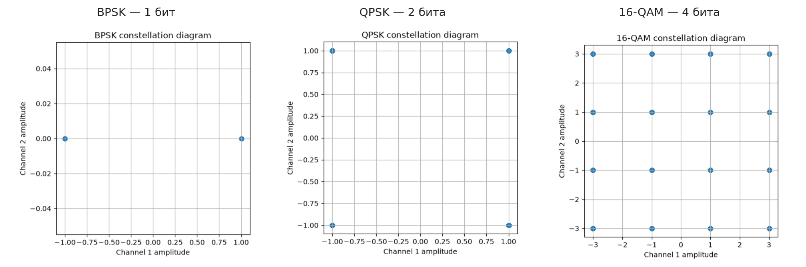

*Рисунок 1 — Сигнальные созвездия трёх схем цифровой модуляции.*

| Модуляция | Число точек $M$ | Бит на символ, $\log_2 M$ |
|---|---:|---:|
| BPSK | 2 | 1 |
| QPSK | 4 | 2 |
| 16-QAM | 16 | 4 |

По мере увеличения числа состояний в одном символе передаётся больше бит. При сопоставимой средней энергии созвездия высокого порядка обычно требуют лучшего SNR для надёжного распознавания соседних точек.

### Вывод по файлу 1

Построены созвездия BPSK, QPSK и 16-QAM. Установлена зависимость количества бит на символ от числа точек модуляции; продемонстрирован компромисс между эффективностью передачи и требованиями к качеству канала.

## Ноутбук D — файл 2. EVM and BER

### 1. Модель AWGN

Сгенерированы случайные отсчёты гауссовского шума с близким к нулю средним значением и исследовано распределение при дисперсиях $0{,}25$, $1$ и $4$:

$$
n\sim\mathcal{N}(0,\sigma^2).
$$

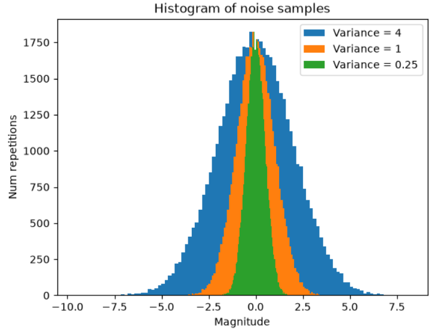

*Рисунок 2 — Увеличение дисперсии приводит к большему разбросу шумовых отсчётов.*

Для добавления комплексного шума к символам в ноутбуке используется масштабирование случайных величин по мощности и заданному SNR.

### 2. Влияние шума на созвездия

При SNR = **10 дБ** получено созвездие QPSK с заметным разбросом точек вокруг четырёх опорных состояний.

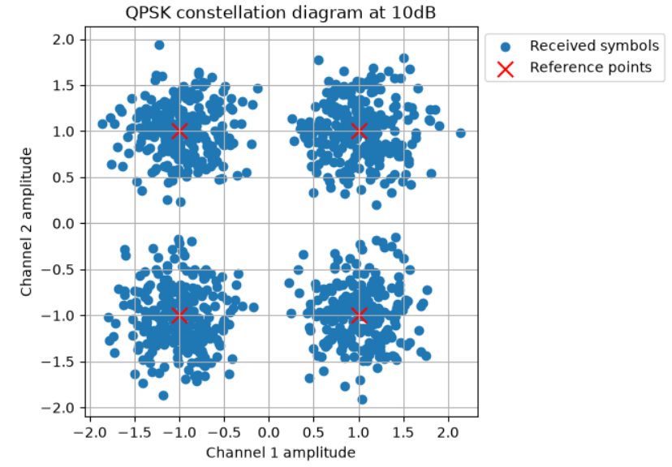

*Рисунок 3 — Созвездие QPSK при воздействии AWGN.*

Для 16-QAM сравниваются уровни шума при SNR = **20 дБ** и **10 дБ**. При меньшем отношении сигнал/шум облака точек сильнее перекрываются, что затрудняет определение переданного символа.

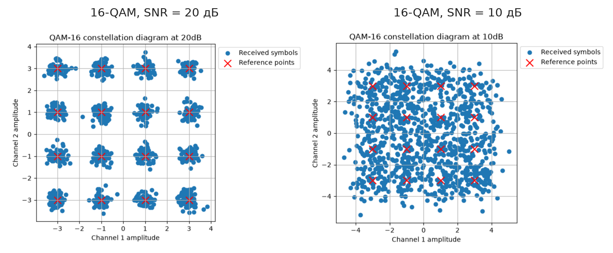

*Рисунок 4 — Влияние SNR на созвездие 16-QAM: справа шум существенно сильнее.*

### 3. Количественная оценка EVM

Для среднеквадратичной величины вектора ошибки рассматривается нормированное отклонение принятых символов от опорных:

$$
\mathrm{EVM}_{\mathrm{RMS}} = 100\%\cdot
\sqrt{\frac{\sum_{k=1}^{N}|S_{\mathrm{rx},k}-S_{\mathrm{ref},k}|^2}
{\sum_{k=1}^{N}|S_{\mathrm{ref},k}|^2}}.
$$

Полученные в ноутбуке значения для 16-QAM:

| SNR | EVM |
|---:|---:|
| 20 дБ | **9,86 %** |
| 10 дБ | **30,52 %** |

Снижение SNR на 10 дБ сопровождается увеличением EVM примерно втрое. Это согласуется с наблюдаемым размытием сигнального созвездия.

### 4. Вероятности ошибок BER и SER

С использованием заданных алгоритмов демодуляции рассчитаны частоты битовых ошибок для BPSK и битовых/символьных ошибок для QPSK в зависимости от $E_b/N_0$.

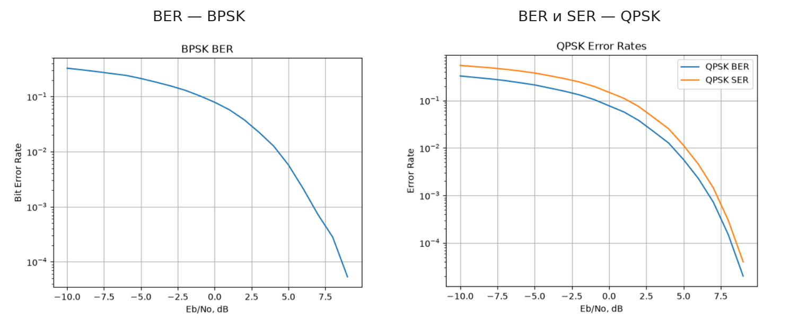

*Рисунок 5 — Уменьшение BER и SER при увеличении энергетического отношения $E_b/N_0$.*

Для QPSK вероятность символьной ошибки (SER) выше битовой (BER), поскольку ошибка в распознавании одного символа не обязательно означает ошибку во всех переданных им битах.

### Вывод по файлу 2

Исследовано влияние AWGN на распределение шумовых отсчётов и принимаемые созвездия. Показано, что с уменьшением SNR увеличивается EVM, а вероятность ошибок возрастает. На графиках BER/SER подтверждено улучшение качества передачи при увеличении $E_b/N_0$.

## Ноутбук D — файл 3. Pulse Shaping

### 1. Исходные BPSK-импульсы и прямоугольное формирование

Сначала сформированы BPSK-символы с амплитудами $-1$ и $+1$. При прямоугольном формировании каждый символ повторяется заданное число раз (`N = 8`), а на приёме используется фильтр скользящего среднего с четырьмя коэффициентами $0{,}25$.

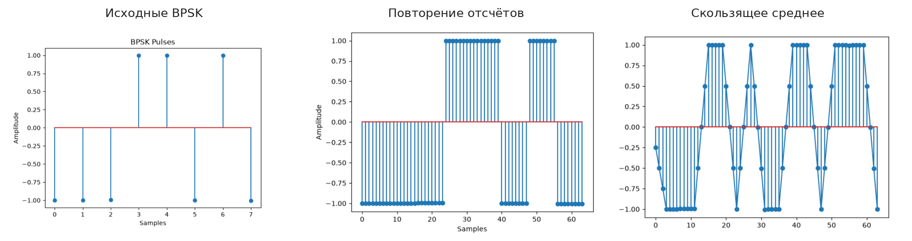

*Рисунок 6 — От отдельных символов к прямоугольной форме и отклику фильтра усреднения.*

В частотной области импульсы без формирования распределяют энергию по широкому спектру. Повторение отсчётов формирует спектральную огибающую, но оставляет боковые составляющие; дополнительная фильтрация изменяет распределение энергии.

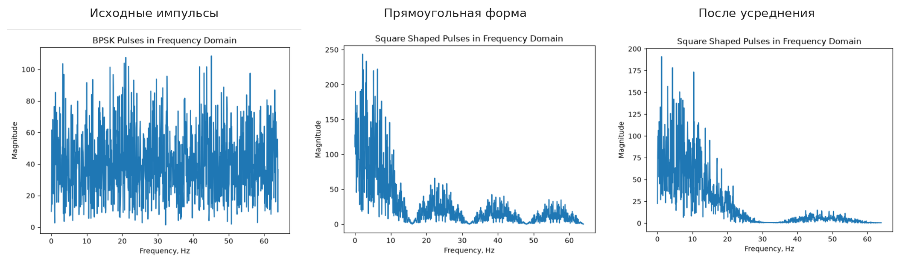

*Рисунок 7 — Спектры исходных BPSK-импульсов, прямоугольной последовательности и сигнала после усреднения.*

Для отдельного периодического прямоугольного сигнала построены временная реализация и спектр, в котором наблюдаются гармонические составляющие.

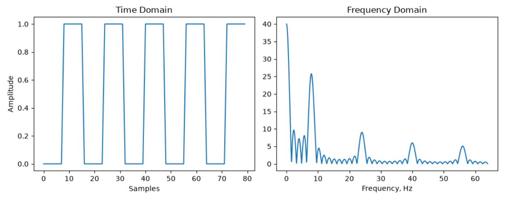

*Рисунок 8 — Резкие изменения амплитуды соответствуют широкому спектру с гармониками.*

### 2. Sinc-фильтр

В качестве идеализированного формирующего импульса рассматривается функция

$$
\operatorname{sinc}\!\left(\frac{t}{T}\right)=
\frac{\sin(\pi t/T)}{\pi t/T}.
$$

Идеальная sinc имеет бесконечную временную протяжённость, поэтому в реальной реализации количество коэффициентов фильтра ограничивается. В ноутбуке сравниваются реализации длиной около 50 и 4 символьных интервалов.

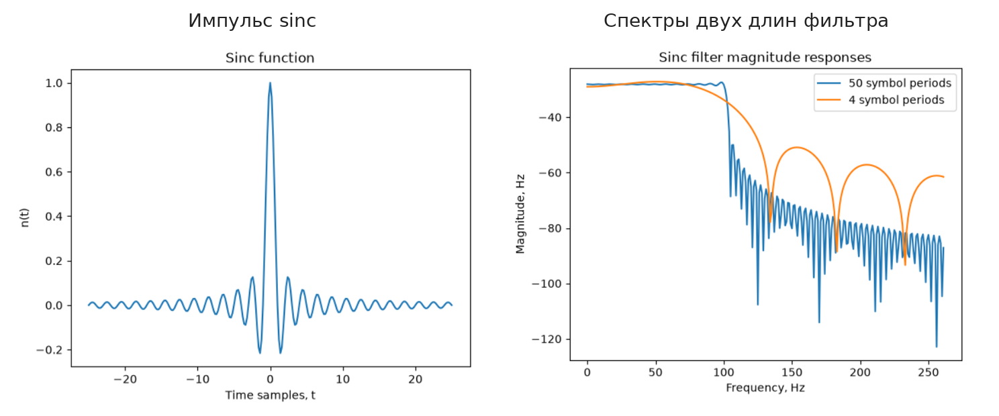

*Рисунок 9 — Форма sinc-импульса и влияние длины фильтра на частотную характеристику.*

Более длинный фильтр обеспечивает более резкий переход между полосой пропускания и подавления, хотя требует большего числа вычислений и вносит задержку.

### 3. Raised Cosine (RC) и параметр roll-off

Фильтр Raised Cosine используется для управления занимаемой полосой и подавления межсимвольной интерференции в моменты принятия решений. Его импульсная характеристика в модели имеет вид:

$$
p_{\mathrm{RC}}(t)=
\frac{\sin(\pi t/T)}{\pi t/T}\cdot
\frac{\cos(\pi\alpha t/T)}{1-(2\alpha t/T)^2},
$$

где $\alpha$ — коэффициент избыточной полосы (*roll-off*). Для идеальной RC-характеристики односторонняя полоса основной частотной области равна $B=(1+\alpha)/(2T)$.

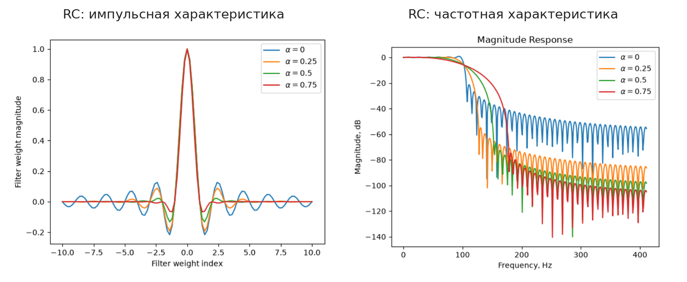

*Рисунок 10 — Изменение временного отклика и частотной характеристики RC при $\alpha=0$, $0{,}25$, $0{,}5$ и $0{,}75$.*

Увеличение $\alpha$ расширяет занимаемую полосу и изменяет характер переходной области. Выбор коэффициента определяется компромиссом между полосой и практической реализацией фильтра.

### 4. Подавление межсимвольной интерференции (ISI)

Для трёх импульсов, сдвинутых друг относительно друга на один символьный интервал, показано RC-формирование. Отсчёты других импульсов в моменты принятия решений обращаются в нуль, поэтому соседние символы не искажают значения друг друга при идеальной синхронизации.

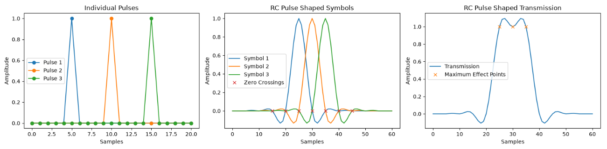

*Рисунок 11 — Исходные импульсы, RC-формирование и суммарная передача; крестиками обозначены точки принятия решений.*

### 5. Root Raised Cosine (RRC) и согласованная фильтрация

В распространённой схеме передачи и приёма используются два согласованных RRC-фильтра. Совместная амплитудно-частотная характеристика формирует отклик RC:

$$
|H_{\mathrm{RRC}}(f)|^2 = H_{\mathrm{RC}}(f).
$$

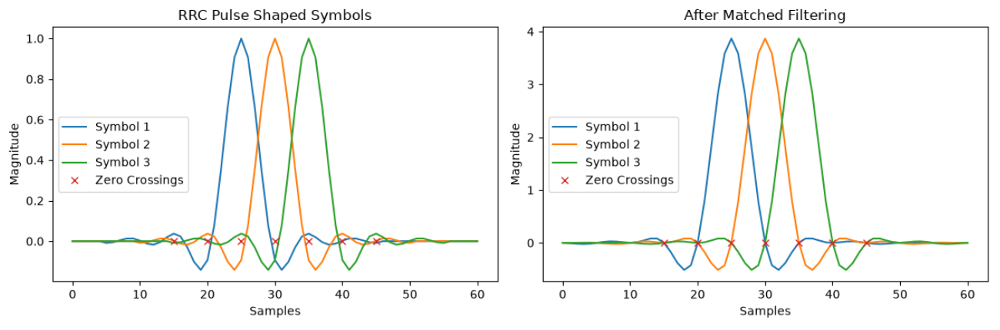

*Рисунок 12 — Импульсы после одиночного RRC и после последовательного применения согласованных фильтров.*

После согласованной фильтрации выражены максимумы полезных символов, а в соседних точках решения уменьшается ISI. Пики на втором графике выше из-за использованного в демонстрации масштабирования; прямое сравнение абсолютных амплитуд без нормировки не проводилось.

### 6. Исправление совместимости Matplotlib

Для запуска примеров на современной версии `Matplotlib` из вызовов `plt.stem()` удалён неподдерживаемый аргумент `use_line_collection=True` (в нескольких ячейках D03):

```python
# Исходный вызов
plt.stem(symbols.real[:8], use_line_collection=True)

# Исправленный вызов
plt.stem(symbols.real[:8])
```

Изменение касается только интерфейса построения графиков и не меняет вычисления сигналов.

### Вывод по файлу 3

Сравнены импульсы BPSK до и после формирования, спектры прямоугольных последовательностей, sinc-фильтры разной длины и RC-характеристики при различных значениях $\alpha$. На примерах RC и согласованных RRC-фильтров рассмотрено соблюдение условия отсутствия межсимвольной интерференции в моменты дискретного решения.

---

## Общий вывод по лабораторной работе №3

В ходе работы изучены основные функции физического уровня беспроводной связи и на программных примерах исследованы цифровые методы модуляции, влияние AWGN и формирование сигналов. При переходе от BPSK к QPSK и 16-QAM число бит на символ увеличивается с одного до четырёх, но для надёжного различения более плотных созвездий требуется более качественный канал.

Сравнение созвездий 16-QAM показало заметное ухудшение при уменьшении SNR с 20 до 10 дБ: измеренная EVM увеличилась **с 9,86 % до 30,52 %**. По кривым BER и SER подтверждена связь между энергетическим отношением $E_b/N_0$ и частотой ошибок.

В экспериментах с формирующими фильтрами установлено, что прямоугольные импульсы создают широкие боковые составляющие спектра, а sinc и RC позволяют управлять занимаемой полосой. На примере двух согласованных RRC-фильтров продемонстрировано восстановление формы импульса с уменьшенной межсимвольной интерференцией в точках принятия решений.

Вся представленная программная часть **Notebook D01–D03 выполнена без RFSoC-платы**.
