# Лабораторная работа №4. Квадратурная модуляция и демодуляция

## Цель работы

Изучить перенос информационного сигнала из базовой полосы частот на несущую и его обратное восстановление, исследовать квадратурную модуляцию и демодуляцию с использованием синфазной (I) и квадратурной (Q) компонент, влияние фазового рассогласования на результат приёма и эквивалентность обычного и комплексного способов представления QAM.

## Исходные данные и программные средства

Практическая часть выполняется в **Jupyter Notebook** с использованием **Python, NumPy и Matplotlib**. Рассматриваются программные эксперименты из набора RFSoC Book, Notebook E:

- `rfsoc_book/notebooks/notebook_E/01_amplitude_modulation.ipynb` — перенос сигнала на несущую, обратное преобразование и фазовая ошибка;
- `rfsoc_book/notebooks/notebook_E/02_qam_modulation.ipynb` — квадратурная передача двух сигналов и их разделение при приёме;
- `rfsoc_book/notebooks/notebook_E/03_complex_qam.ipynb` — комплексная форма модуляции, перенос спектра и демодуляция с комплексным гетеродином.

В данном документе приведены результаты **E01, E02 и E03**. Иллюстрации получены при выполнении этих ноутбуков; математические соотношения соответствуют изучаемым в них моделям. Эксперименты выполнены программно, без измерений на аппаратном тракте.

Общие параметры модели:

| Параметр | Значение | Назначение |
|---|---:|---|
| $f_s$ | 4096 МГц | Частота дискретизации |
| $N_{FFT}$ | 2048 | Число отсчётов для построения спектра |
| $f_c$ | 1400 МГц | Частота несущей |
| $f_{b1}$ | 64 МГц | Частота первого информационного сигнала |
| $A_1$ | 2 | Амплитуда первого информационного сигнала |
| $f_{b2}$ | 32 МГц | Частота второй I/Q-компоненты (E02–E03) |
| $A_2$ | 1 | Амплитуда второй I/Q-компоненты (E02–E03) |

## Теоретические сведения

**Модуляция** — преобразование базового сигнала для передачи на заданной частоте несущей. В рассматриваемой модели перенос достигается перемножением сигналов во временной области. Благодаря свойствам преобразования Фурье умножение на гармоническую несущую приводит к появлению спектральных составляющих вокруг частоты $f_c$.

**Демодуляция** — обратный перенос спектра в базовую полосу. После перемножения принятого сигнала с гетеродином возникает полезная низкочастотная составляющая и дополнительные высокочастотные компоненты. Для их подавления используется фильтр нижних частот (ФНЧ).

В **квадратурной системе** два базовых сигнала передаются через ортогональные несущие — косинус (I) и синус (Q). Ортогональность позволяет разделить компоненты при синхронной демодуляции; фазовое рассогласование нарушает такое разделение.

---

# 1. Notebook E01 — амплитудная модуляция и демодуляция

## 1.1. Исходный базовый сигнал

В первом эксперименте генерируется гармонический сигнал частотой 64 МГц и амплитудой 2:

$$
g(t)=A\cos(2\pi f_b t),\qquad A=2,\quad f_b=64\ \text{МГц}.
$$

Дискретное время задаётся по формуле $t_n=n/f_s$. С помощью быстрого преобразования Фурье строится амплитудный спектр сигнала.

```python
fs = 4096e6
fb = 64e6
A = 2
N_fft = 2048
t = np.arange(N_fft) / fs

g = A * np.cos(2 * np.pi * fb * t)
g_fft_result = np.fft.fft(g, N_fft)
```

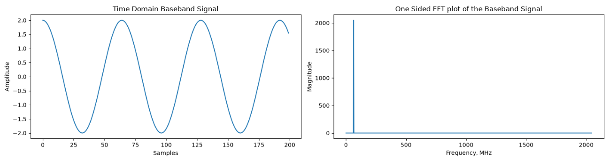

**Результат.** Во временной области наблюдается косинусоида с амплитудой 2. На одностороннем спектре присутствует выраженный пик в области **64 МГц**, что соответствует заданной частоте.

## 1.2. Формирование несущей

Для переноса спектра создаётся высокочастотная несущая:

$$
c(t)=\cos(2\pi f_c t),\qquad f_c=1400\ \text{МГц}.
$$

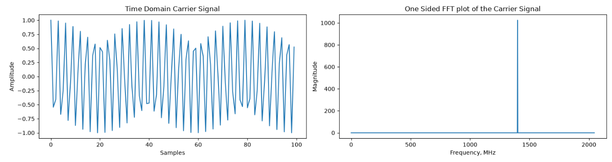

**Результат.** Частота колебаний во временной области значительно выше, чем у базового сигнала; спектральный максимум находится около **1400 МГц**.

## 1.3. Перенос сигнала на несущую

Модуляция осуществляется умножением $g(t)$ на $c(t)$:

$$
\begin{aligned}
s(t)&=g(t)c(t)\\
&=A\cos(2\pi f_b t)\cos(2\pi f_c t)\\
&=\frac{A}{2}\cos\bigl(2\pi(f_c-f_b)t\bigr)
+\frac{A}{2}\cos\bigl(2\pi(f_c+f_b)t\bigr).
\end{aligned}
$$

Поэтому ожидаемые частоты боковых составляющих:

$$
f_c-f_b=1336\ \text{МГц},\qquad
f_c+f_b=1464\ \text{МГц}.
$$

```python
fc = 1400e6
c = np.cos(2 * np.pi * fc * t)
s = g * c
s_fft_result = np.fft.fft(s, N_fft)
```

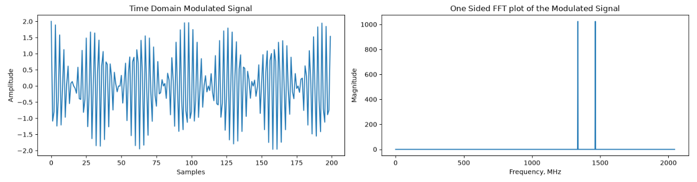

**Результат.** Спектр исходного сигнала перенесён в радиочастотную область: хорошо видны пики около 1336 и 1464 МГц. Расстояние между ними составляет $2f_b=128$ МГц. В данном опыте это расстояние между двумя спектральными линиями гармонического сигнала, а не измеренная ширина полосы произвольного модулированного сообщения.

## 1.4. Синхронная демодуляция до фильтрации

На приёмной стороне сигнал повторно умножается на несущую:

$$
\begin{aligned}
x(t)&=s(t)c(t)=g(t)\cos^2(2\pi f_c t)\\
&=\frac{A}{2}\cos(2\pi f_b t)
+\frac{A}{4}\cos\bigl(2\pi(2f_c-f_b)t\bigr)
+\frac{A}{4}\cos\bigl(2\pi(2f_c+f_b)t\bigr).
\end{aligned}
$$

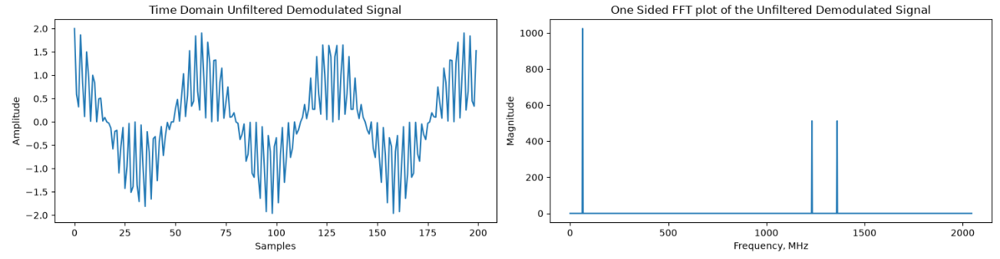

**Результат.** Полезная компонента возвращается к частоте 64 МГц, однако одновременно остаются высокочастотные составляющие. Из-за частоты дискретизации 4096 МГц составляющие около $2f_c\pm f_b$ отображаются на графике в виде алиасов: **1232 и 1360 МГц**. Для выделения исходного сигнала необходим ФНЧ.

## 1.5. Фильтрация и восстановление базовой полосы

В ноутбуке ФНЧ строится оконным методом. Идеальный sinc-отклик умножается на окно Блэкмана и нормируется:

$$
h[n]=\frac{h_d[n]w[n]}{\sum_k h_d[k]w[k]},\qquad
h_d[n]=\operatorname{sinc}\!\left(2f_{cutoff}\left[n-\frac{N-1}{2}\right]\right).
$$

Здесь `f_cutoff = 0.1` — нормированная частота среза, `b = 0.08` — параметр переходной полосы; $\operatorname{sinc}(x)=\sin(\pi x)/(\pi x)$.

```python
f_cutoff = 0.1
b = 0.08
N = int(np.ceil(4 / b))
if not N % 2:
    N += 1
n = np.arange(N)

h = np.sinc(2 * f_cutoff * (n - (N - 1) / 2))
h = h * np.blackman(N)
h /= np.sum(h)
u = np.convolve(x, h)
```

После удаления высокочастотных составляющих в установившемся режиме:

$$
u(t)\approx\frac{A}{2}\cos(2\pi f_b t).
$$

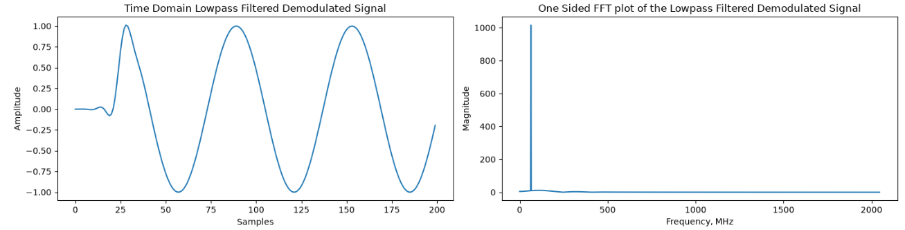

**Результат.** На спектре остаётся основной пик около 64 МГц; амплитуда восстановленной косинусоиды составляет примерно **1** вместо исходных **2**. В начале временного графика заметен переходный процесс и задержка, связанная с конечной длиной КИХ-фильтра.

## 1.6. Влияние ошибки фазы гетеродина

При фазовом рассогласовании локальной несущей на угол $\theta$ амплитуда полезной составляющей после ФНЧ зависит от $\cos\theta$:

$$
u_{\theta}(t)\approx\frac{A}{2}\cos(\theta)\cos(2\pi f_b t).
$$

В эксперименте задан угол $\theta=\pi/3=60^\circ$:

$$
\cos\left(\frac{\pi}{3}\right)=\frac12,
\qquad A_{out}=\frac{A}{4}=0.5.
$$

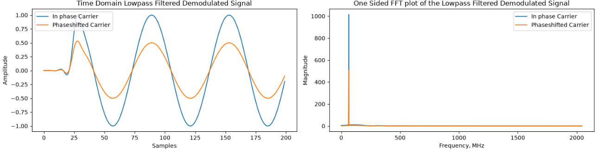

**Результат.** Оранжевая кривая имеет примерно вдвое меньшую амплитуду, чем синяя кривая для синхронного приёма. Следовательно, точная фазовая синхронизация необходима для корректного восстановления амплитуды.

### Вывод по E01

В ходе эксперимента выполнен перенос гармонического сигнала 64 МГц на несущую 1400 МГц и обратный перенос в базовую полосу. На спектре модулированного сигнала получены две боковые составляющие — 1336 и 1464 МГц. После синхронной демодуляции и низкочастотной фильтрации восстановлен исходный тон с амплитудой, равной половине исходной. При фазовой ошибке 60° наблюдалось дополнительное уменьшение амплитуды вдвое.

---

# 2. Notebook E02 — квадратурная амплитудная модуляция

## 2.1. Формирование двух информационных сигналов

Для демонстрации квадратурной передачи создаются два гармонических сигнала:

$$
g_1(t)=A_1\cos(2\pi f_{b1}t),\quad f_{b1}=64\ \text{МГц},\quad A_1=2;
$$

$$
g_2(t)=A_2\cos(2\pi f_{b2}t),\quad f_{b2}=32\ \text{МГц},\quad A_2=1.
$$

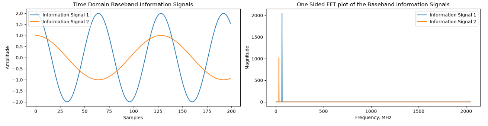

**Результат.** Сигналы имеют разные частоты и амплитуды. Это позволяет проследить, сохраняются ли обе компоненты при передаче и последующем разделении каналов I и Q.

## 2.2. Квадратурные несущие и модуляция

Синфазный сигнал умножается на косинус, квадратурный — на синус со знаком минус:

$$
s_I(t)=g_1(t)\cos(2\pi f_ct),\qquad
s_Q(t)=-g_2(t)\sin(2\pi f_ct).
$$

Косинус и синус сдвинуты друг относительно друга на 90°. Благодаря ортогональности при синхронной обработке эти два сигнала можно разделить.

```python
g1 = A1 * np.cos(2 * np.pi * fb * t)
g2 = A2 * np.cos(2 * np.pi * fb2 * t)

s1 = g1 * np.cos(2 * np.pi * fc * t)
s2 = -g2 * np.sin(2 * np.pi * fc * t)
```

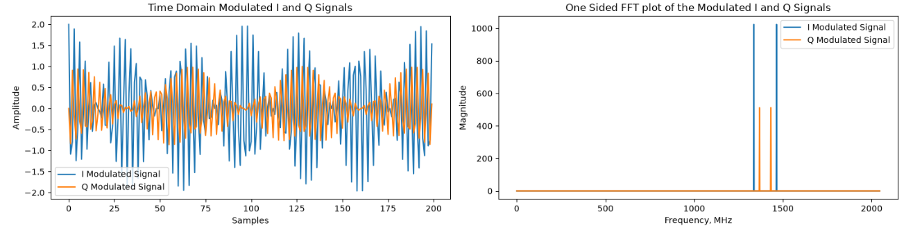

**Результат.** На спектре I-канала наблюдаются составляющие около 1336 и 1464 МГц, а на спектре Q-канала — около 1368 и 1432 МГц. Оба канала используют общую несущую частоту 1400 МГц.

## 2.3. Объединение каналов в один передаваемый сигнал

Радиочастотный сигнал формируется суммированием:

$$
\boxed{y(t)=g_1(t)\cos(2\pi f_ct)-g_2(t)\sin(2\pi f_ct).}
$$

```python
y = s1 + s2
y_fft_result = np.fft.fft(y, N_fft)
```

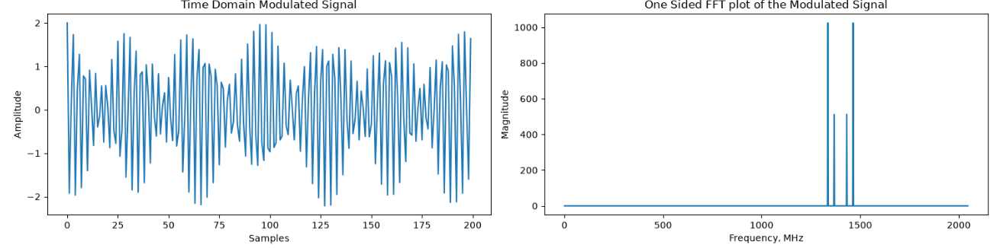

**Результат.** В одном спектре видны составляющие обоих исходных сигналов. Передача информации через две ортогональные компоненты позволяет совместно использовать одну радиочастотную полосу.

## 2.4. Квадратурная демодуляция без фильтрации

На приёмнике суммарный сигнал умножается на два опорных колебания:

$$
x_I(t)=y(t)\cos(2\pi f_ct),\qquad
x_Q(t)=-y(t)\sin(2\pi f_ct).
$$

С учётом тригонометрических тождеств:

$$
\begin{aligned}
x_I(t)&=\frac12 g_1(t)
+\frac12g_1(t)\cos(4\pi f_ct)
-\frac12g_2(t)\sin(4\pi f_ct),\\
x_Q(t)&=\frac12 g_2(t)
-\frac12g_1(t)\sin(4\pi f_ct)
-\frac12g_2(t)\cos(4\pi f_ct).
\end{aligned}
$$

В формулах присутствуют полезные низкочастотные слагаемые и паразитные компоненты в области удвоенной несущей. Их нужно удалить фильтрацией.

**Примечание к исходному ноутбуку:** в текстовой формуле для $x_Q$ в Notebook E02 высокочастотное слагаемое с $g_2(t)\cos(4\pi f_ct)$ приведено со знаком «+». При раскрытии используемого в коде выражения $x_Q=-y\sin(2\pi f_ct)$ получается знак «−», поскольку $\sin^2 x=(1-\cos2x)/2$. Выше записан алгебраически согласованный с кодом результат.

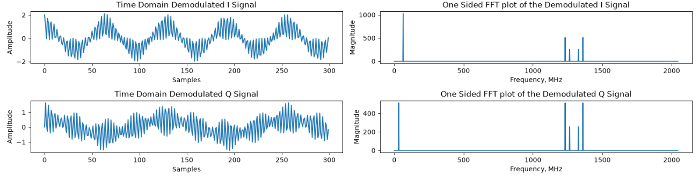

**Результат.** Низкочастотные составляющие уже присутствуют, но временные сигналы существенно искажены наложенными высокочастотными колебаниями.

## 2.5. Восстановление I/Q-компонент после ФНЧ

Для обоих выходов используется тот же тип оконного низкочастотного фильтра, что и в E01:

```python
z1 = np.convolve(x1, h)
z2 = np.convolve(x2, h)
```

После фильтрации в установившемся режиме:

$$
z_I(t)\approx\frac12 g_1(t),\qquad
z_Q(t)\approx\frac12 g_2(t).
$$

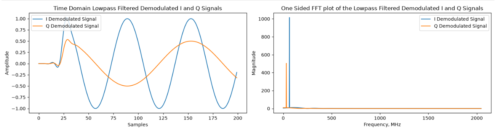

**Результат.** Восстановлены два исходных тона — около 64 МГц и 32 МГц. Максимальные амплитуды составляют примерно **1** для I и **0,5** для Q. В начальной части временных графиков наблюдается переходный процесс фильтра.

## 2.6. Влияние фазового рассогласования

Если фазовый сдвиг локального гетеродина равен $\theta$, после фильтрации получается не чистое разделение исходных сигналов, а их смесь:

$$
\begin{aligned}
z_I^{(\theta)}(t)&\approx\frac12\bigl[g_1(t)\cos\theta+g_2(t)\sin\theta\bigr],\\
z_Q^{(\theta)}(t)&\approx\frac12\bigl[-g_1(t)\sin\theta+g_2(t)\cos\theta\bigr].
\end{aligned}
$$

При $\theta=60^\circ$ коэффициенты равны $\cos\theta=0.5$ и $\sin\theta\approx0.866$. Это приводит к заметной перекрёстной примеси каналов.

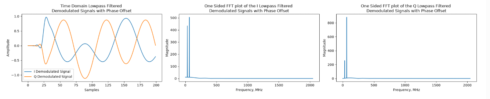

**Результат.** На спектрах каждого выходного канала присутствуют обе исходные частоты — 32 и 64 МГц. На временных графиках возникают смешанные колебания, в отличие от синхронного случая. Следовательно, фазовая ошибка препятствует корректному разделению I/Q-компонент.

### Вывод по E02

В эксперименте реализована квадратурная модуляция двух независимых гармонических сигналов на общей несущей 1400 МГц. После синхронной демодуляции и ФНЧ обе исходные частоты восстановлены в отдельных каналах I и Q. Показано, что фазовое рассогласование 60° вызывает взаимное проникновение сигналов между каналами и ухудшает качество разделения.

---

---

# 3. Notebook E03 — комплексное представление QAM

## 3.1. Формирование комплексного информационного сигнала

В предыдущем эксперименте синфазный и квадратурный каналы формировались раздельно. В E03 оба сигнала объединяются в одну **комплексную огибающую**:

$$
g(t)=g_1(t)+j g_2(t), \qquad j^2=-1,
$$

где синфазная часть $I(t)=g_1(t)$ и квадратурная часть $Q(t)=g_2(t)$ определяются как

$$
\begin{aligned}
g_1(t)&=A_1\cos(2\pi f_{b1}t), &A_1&=2, &f_{b1}&=64\ \text{МГц},\\
g_2(t)&=A_2\cos(2\pi f_{b2}t), &A_2&=1, &f_{b2}&=32\ \text{МГц}.
\end{aligned}
$$

Комплексная форма сохраняет обе компоненты независимо: действительная часть описывает I, а мнимая — Q.

```python
g1 = A1 * np.cos(2 * np.pi * fb * t)
g2 = A2 * np.cos(2 * np.pi * fb2 * t)
g_complex = g1 + 1j * g2

g_complex_fft_result = np.fft.fft(g_complex, N_fft)
```

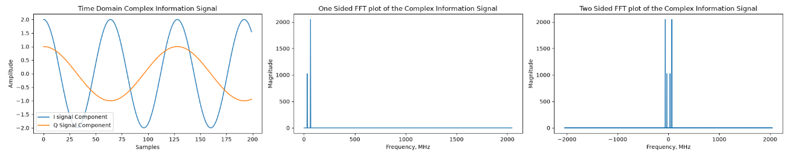

**Результат.** По временной диаграмме I-компонента имеет амплитуду 2 и частоту 64 МГц, а Q-компонента — амплитуду 1 и частоту 32 МГц. Двусторонний спектр показывает составляющие с положительными и отрицательными частотами. В отличие от вещественных сигналов, спектр произвольного комплексного сигнала не обязан обладать сопряжённой симметрией.

## 3.2. Комплексная несущая и формула Эйлера

Для модуляции используется комплексная экспонента частотой $f_c=1400$ МГц:

$$
c(t)=e^{j2\pi f_ct}=\cos(2\pi f_ct)+j\sin(2\pi f_ct).
$$

Синфазная и квадратурная части такой несущей сдвинуты друг относительно друга на $90^\circ$.

```python
fc = 1400e6
c_complex = np.exp(1j * 2 * np.pi * fc * t)
```

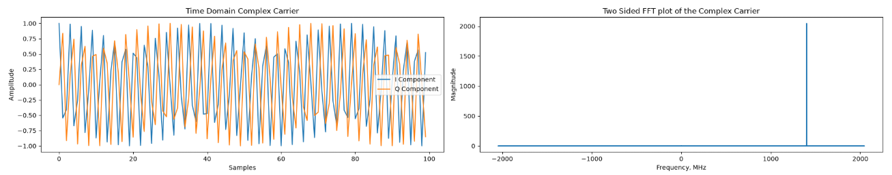

**Результат.** На двустороннем спектре комплексной экспоненты находится один основной пик при **+1400 МГц**. В отличие от вещественного косинуса отдельная зеркальная спектральная линия на $-1400$ МГц отсутствует.

## 3.3. Перенос комплексной огибающей на несущую

Умножение информационного комплексного сигнала на экспоненту приводит к переносу спектра:

$$
v(t)=g(t)e^{j2\pi f_ct}.
$$

После подстановки формулы Эйлера получаем:

$$
\begin{aligned}
v(t)
&=[g_1(t)+jg_2(t)]\,[\cos(2\pi f_ct)+j\sin(2\pi f_ct)]\\
&=\underbrace{[g_1(t)\cos(2\pi f_ct)-g_2(t)\sin(2\pi f_ct)]}_{\operatorname{Re}\{v(t)\}}\\
&\quad+j\underbrace{[g_1(t)\sin(2\pi f_ct)+g_2(t)\cos(2\pi f_ct)]}_{\operatorname{Im}\{v(t)\}}.
\end{aligned}
$$

```python
v = g_complex * c_complex
v_fft_result = np.fft.fft(v, N_fft)
```

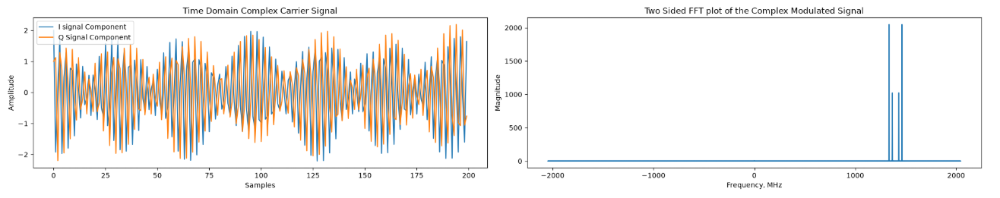

**Результат.** После модуляции спектральные компоненты оказываются в окрестности несущей 1400 МГц. В рассматриваемом случае ожидаются частоты $f_c\pm f_{b1}$ и $f_c\pm f_{b2}$, то есть **1336, 1368, 1432 и 1464 МГц**. График подтверждает перенос информационных составляющих в радиочастотную область.

## 3.4. Выделение вещественного передаваемого сигнала

Физически передаваемый радиочастотный сигнал представляется вещественной частью $v(t)$:

$$
\boxed{y(t)=\operatorname{Re}\{v(t)\}
=g_1(t)\cos(2\pi f_ct)-g_2(t)\sin(2\pi f_ct).}
$$

Полученное выражение **совпадает с формулой квадратурной модуляции E02**. Следовательно, комплексная запись — это другой, более компактный способ описания той же передачи I/Q-компонент.

```python
y = v.real
y_fft_result = np.fft.fft(y, N_fft)
```

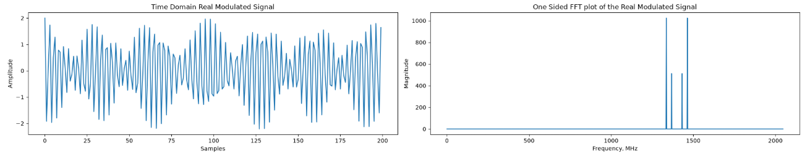

**Результат.** Вещественная форма модулированного сигнала и её односторонний спектр совпадают по структуре с суммарным сигналом, построенным в E02. В спектре видны четыре боковые составляющие, соответствующие двум исходным частотам.

## 3.5. Комплексный гетеродин для демодуляции

Для обратного переноса спектра приёмник использует комплексную экспоненту с отрицательным знаком в показателе:

$$
c_{rx}(t)=e^{-j2\pi f_ct}=\cos(2\pi f_ct)-j\sin(2\pi f_ct).
$$

```python
complex_demod_carrier = np.exp(-1j * 2 * np.pi * fc * t)
```

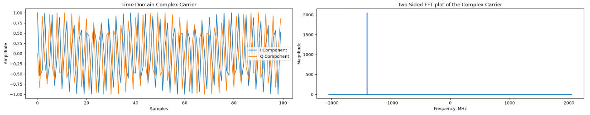

**Результат.** На двустороннем спектре основной пик располагается при **−1400 МГц**. Этот гетеродин переносит частотные компоненты принятого сигнала в сторону базовой полосы.

## 3.6. Комплексная демодуляция без ФНЧ

Принятый вещественный сигнал перемножается с комплексным гетеродином:

$$
x(t)=y(t)e^{-j2\pi f_ct}.
$$

Поскольку $y(t)=\tfrac12[v(t)+v^*(t)]$, после подстановки выражения для $v(t)$ получается:

$$
\boxed{x(t)=\frac12g(t)+\frac12g^*(t)e^{-j4\pi f_ct}.}
$$

Первое слагаемое соответствует восстановленному базовому сигналу; второе — нежелательной высокочастотной копии (образу), которую необходимо подавить ФНЧ.

```python
x = y * complex_demod_carrier
x_fft_result = np.fft.fft(x, N_fft)
```

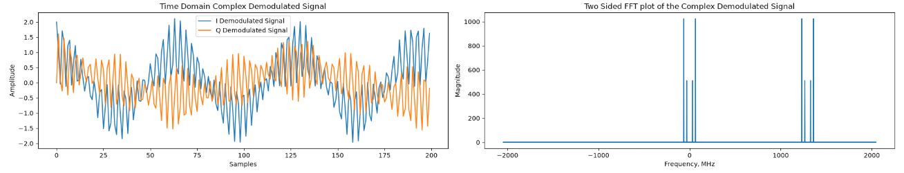

**Результат.** На спектре присутствуют компоненты около 0 МГц, соответствующие полезному сигналу, и дополнительные составляющие. Непрерывно-временной образ расположен около $-2f_c=-2800$ МГц; в дискретной модели с $f_s=4096$ МГц он отображается вследствие наложения спектров около **+1296 МГц** (с боковыми составляющими). Поэтому непосредственно после перемножения полезный сигнал ещё не выделен полностью.

## 3.7. Фильтрация и восстановление I/Q

Для подавления высокочастотного образа используется тот же тип ФНЧ, что и в E01–E02: оконный sinc-фильтр с окном Блэкмана. Его импульсная характеристика:

$$
h[n]=\frac{\operatorname{sinc}\!\left(2f_{cutoff}(n-\frac{N-1}{2})\right)w_{Blackman}[n]}{\sum_k\operatorname{sinc}\!\left(2f_{cutoff}(k-\frac{N-1}{2})\right)w_{Blackman}[k]}.
$$

Операция фильтрации производится свёрткой:

```python
# h рассчитан по параметрам f_cutoff = 0.1 и b = 0.08
z = np.convolve(x, h)
z_fft_result = np.fft.fft(z, N_fft)
```

После подавления образа:

$$
\boxed{z(t)\approx\frac12g(t)=\frac12g_1(t)+j\frac12g_2(t).}
$$

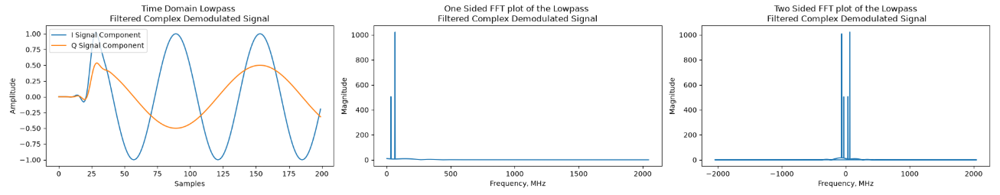

**Результат.** На временном графике вновь видны независимые составляющие с частотами **64 и 32 МГц**. Их амплитуды составляют приблизительно **1 и 0,5**, то есть вдвое меньше исходных значений из-за использованной схемы демодуляции без дополнительного усиления. Высокочастотный образ подавлен, что заметно по спектрам. В начале временного графика наблюдаются переходные процессы и групповая задержка конечного КИХ-фильтра.

### Вывод по E03

В E03 сформирована комплексная огибающая $g(t)=I(t)+jQ(t)$ и выполнен перенос спектра на несущую посредством комплексной экспоненты. Выделение действительной части модулированного сигнала приводит к той же квадратурной формуле, что использовалась в E02. Обратное перемножение с сопряжённой экспонентой и последующая низкочастотная фильтрация восстанавливают I/Q-компоненты с амплитудами, уменьшенными вдвое в выбранной схеме. Комплексное описание позволяет объединить две действительные ветви в одну математическую модель.

---

# Общий вывод по лабораторной работе №4

В ходе выполнения **Notebook E01, E02 и E03** изучены перенос информационного сигнала на несущую и обратно, квадратурная обработка двух независимых компонентов и комплексная форма QAM.

В **E01** получены боковые составляющие на частотах 1336 и 1464 МГц при переносе исходного тона 64 МГц на несущую 1400 МГц. Синхронная демодуляция с ФНЧ восстановила базовую частоту; фазовая ошибка 60° вызвала дополнительное ослабление сигнала.

В **E02** два тона частотой 64 и 32 МГц объединены в один радиочастотный сигнал с помощью ортогональных косинусной и синусной несущих. После синхронной обработки сигналы разделены по I- и Q-каналам. При фазовом рассогласовании наблюдалось смешивание этих каналов.

В **E03** подтверждено математическое соответствие двух способов представления квадратурной модуляции: вещественной суммы I/Q-ветвей и действительной части комплексно-модулированного сигнала. Демодуляция комплексным гетеродином совместно с ФНЧ позволила восстановить обе низкочастотные составляющие.

**Итог:** модуляция позволяет переносить информацию в требуемую радиочастотную полосу, квадратурная обработка — совместно использовать одну несущую для двух компонент, а комплексная запись упрощает математическое представление этих операций. Для качественного восстановления необходимы фильтрация паразитных спектральных компонент и точная синхронизация гетеродина с передатчиком.
